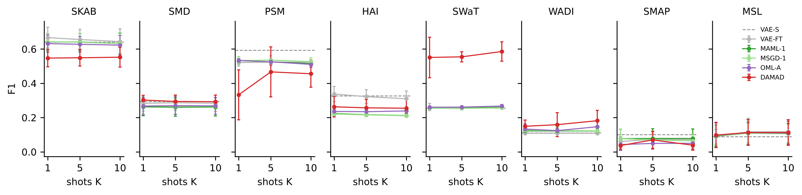
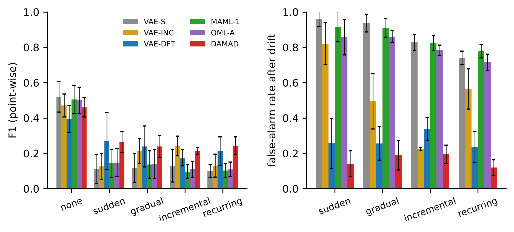
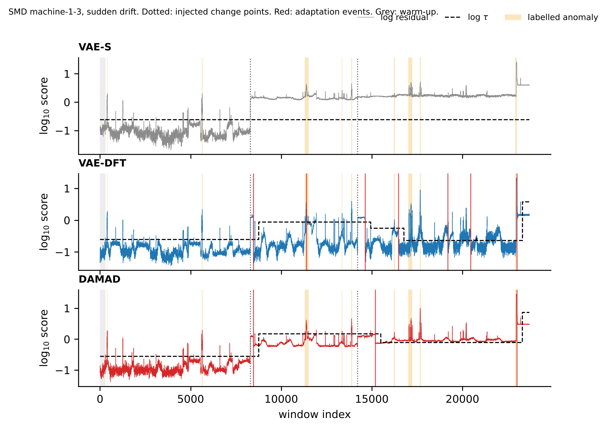
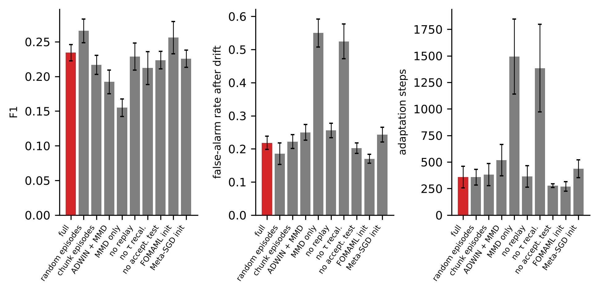

# Abstract {.unnumbered}

Sensor streams from industrial plants have to be watched for faults with almost no labelled examples, under distributions that keep moving, and with new fault types showing up after deployment. Meta-learning is built for the few-shot part of that problem, but a systematic review we carried out of 66 peer-reviewed papers (2020--2025) found no method that combines meta-learning with online adaptation on a non-stationary stream and is evaluated on an industrial benchmark. This paper closes that gap in three steps. First, we condense the review into a four-dimensional taxonomy of meta-learning anomaly detectors and a benchmarking protocol with strictly point-wise metrics, controlled drift injection, and three streaming measures (detection latency, adaptation steps, false-alarm rate under drift). Second, we build DAMAD, the Drift-Aware Meta-Adaptive Detector, as a working system: a MAML++-initialised variational autoencoder that adapts in K gradient steps when a regime change is confirmed, a regime-indexed memory that replays past regimes during meta-updates, a gated extreme-value threshold, and a champion/challenger check that undoes an adaptation if the old model turns out to fit the following data better. Building it changed two design decisions from our earlier conceptual sketch: the drift gate has to watch the model residual rather than the raw input, and a change has to be confirmed by the gain it brings, otherwise long anomalies masquerade as drift. Third, we run DAMAD against eight baselines (Isolation Forest, static, fine-tuned, incrementally updated and drift-aware VAEs, MAML and Meta-SGD adapted once, and an MMD-triggered meta-adapter) on eight benchmarks, SWaT, WADI, HAI 21.03, SMAP, MSL, SMD, SKAB and PSM, over five seeds, four drift patterns and ten ablations, 19,650 streaming runs in all. Without injected drift, the static VAE is as good as any meta-learned detector on six of the eight, and the number of support windows makes no difference between one and ten: the initialisation is not the bottleneck. SWaT and WADI are the exception, because their attack recordings sit at a different operating point from their normal recordings: there the static and adapt-once detectors alarm on 49--74 % of normal steps and DAMAD on 4--6 %, with F1 55 against 26 on SWaT. Under injected drift the static and adapt-once detectors alarm on 73--87 % of normal steps pooled (95--100 % on SWaT, WADI and PSM) and do not recover; DAMAD keeps the rate at 17--30 %, recovers within 230--440 windows, and has the best pooled point-wise F1 under every pattern, driven by SWaT, WADI and SMD. On HAI it brings no gain, on SMAP and MSL every method is weak, and its recalibrated thresholds cost it detection latency everywhere. The ablations show that threshold recalibration and the residual-side gate carry the result, the acceptance test matters where anomalies are long, replay helps on some streams and hurts on SWaT, and the choice of meta-learner is secondary. Code, loaders and every result table are released.

**Keywords:** meta-learning; few-shot learning; anomaly detection; industrial Internet of Things; concept drift; streaming data; variational autoencoder; benchmarking protocol.

# 1 Introduction

Industrial Internet of Things (IIoT) installations stream readings from thousands of sensors, and someone, or something, has to notice when a reading pattern means that a pump is failing, a valve is stuck, or a controller has been tampered with [@chandola2009survey; @pang2021deep]. A missed anomaly costs production time and sometimes equipment or safety. Deep anomaly detection (AD) has produced a long list of methods for this: autoencoders, variational autoencoders [@kingma2014vae], LSTM predictors, adversarial reconstruction [@audibert2020usad] and others, with strong numbers on public benchmarks.

The numbers rely on three assumptions that an IIoT deployment rarely satisfies at once. The first is that labelled faults exist in useful quantity. A turbine that fails once in two years does not provide a training set. The second is that the data distribution is stationary. Equipment ages, loads shift with the season, and operators change set-points, so the statistics of normal operation move [@gama2014drift; @lu2019drift]. The third is that the fault types at deployment time are the ones seen during training. New failure modes appear, and the detector is expected to flag them from a handful of examples. Each problem has its own literature. What is missing is a method, and an evaluation, for the case where all three hold together.

Meta-learning is the natural starting point for the few-shot side. Train one learner across many tasks instead of one, and what comes out is an initialisation, an embedding or a memory that fits a fresh task from a handful of examples [@finn2017maml; @snell2017proto; @hospedales2022meta]. Treating each operating regime, or each fault type, as a task makes the application to IIoT straightforward in principle. A few papers have done exactly that [@moon2023mavae; @feng2024metauad; @tian2024omlog]. What we found when we reviewed the field systematically is that the meta-learning methods are trained offline and never updated, the streaming methods do not meta-learn, and almost none of either group is evaluated on an established industrial benchmark.

An earlier version of this work, accepted at PCEMS 2026, reported the review and sketched a conceptual architecture for the empty cell of the resulting taxonomy. It did not build or evaluate it. This paper does. We kept the taxonomy and the review findings, rewrote the protocol around what we learned while running it, and report what it took to make the architecture work on four public datasets.

Five things come out of this work.

1. A four-dimensional taxonomy of meta-learning AD methods (paradigm, detection mechanism, streaming capability, industrial validation) grounded in a PRISMA-style review of 66 papers, and a gap map showing that the online meta-adaptive column of that taxonomy is empty (Section 3).
2. A benchmarking protocol for this class of methods: open datasets, synthetic drift injected at known change points, strictly point-wise metrics with no point-adjust, three streaming metrics, and a fixed set of baselines and ablations (Section 4).
3. DAMAD, a working online meta-adaptive detector with four modules that each map to one of three sub-problems we identify. Two design choices differ from our earlier sketch, and we explain why with evidence (Section 5).
4. An evaluation on SWaT, WADI, HAI 21.03, SMAP, MSL, SMD, SKAB and PSM, five seeds, four drift patterns, eight baselines and ten ablations, with detection latency, adaptation speed, false-alarm rate under drift and computational cost reported alongside F1 and AUROC (Sections 6 and 7). The results are not uniformly in the method's favour, and we report where they are not.
5. An open implementation in which every method, baseline and ablation is a configuration of one streaming loop, so the comparison is like for like.

The rest of the paper runs in this order. Section 2 covers the background on AD, meta-learning and drift. Section 3 condenses the review into the taxonomy and the gap map. Section 4 sets out the three sub-problems and the protocol, and Section 5 presents DAMAD. The setup is in Section 6 and the results in Section 7; Section 8 goes through the limitations and Section 9 closes.

# 2 Background

## 2.1 Anomaly detection on multivariate streams

We consider a multivariate stream $x_1, x_2, \dots$ with $x_t \in \mathbb{R}^d$. A detector assigns a score $s(x_t)$ to each step and raises an alarm when $s(x_t) > \tau$. Chandola et al. [@chandola2009survey] distinguish point anomalies (one aberrant reading), contextual anomalies (normal in isolation, aberrant given recent history) and collective anomalies (a sequence that is only aberrant as a whole). Industrial faults are mostly of the last two kinds, which is why detectors work on windows rather than single readings.

The semi-supervised formulation fits IIoT best: train on normal data only, score by departure from learned normality. Reconstruction-based models dominate this formulation. An autoencoder or VAE [@kingma2014vae] learns to reproduce normal windows and scores a window by its reconstruction error,

$$ s(x) = \lVert x - \mathrm{Dec}(\mathrm{Enc}(x)) \rVert^2 \qquad \text{(1)} $$

Every method in that family assumes that the training distribution is the deployment distribution. When it is not, the error in Eq. (1) rises for normal data too, and the model has no way of knowing that it is now wrong [@kermenov2023drift; @wahab2022online].

## 2.2 Meta-learning

Meta-learning makes the learning procedure the object of optimisation [@hospedales2022meta]. Optimisation-based methods learn a parameter initialisation $\theta^*$ from which a few gradient steps on a small support set $S_i$ give a good model for task $T_i$. MAML [@finn2017maml] writes this as an inner step,

$$ \theta_i' = \theta - \alpha \nabla_\theta \mathcal{L}_{S_i}(\theta) \qquad \text{(2)} $$

and an outer step over tasks evaluated on their query sets $Q_i$,

$$ \theta \leftarrow \theta - \beta \nabla_\theta \sum_i \mathcal{L}_{Q_i}(\theta_i') \qquad \text{(3)} $$

MAML++ [@antoniou2019mamlpp] stabilises this with per-layer, per-step inner learning rates and a multi-step query loss; Meta-SGD [@li2017metasgd] learns a per-parameter inner learning rate; first-order variants [@nichol2018fomaml] drop the second derivative in Eq. (3). Because the learner can be any differentiable model, an autoencoder works as the base learner, which is what makes optimisation-based meta-learning the right paradigm for reconstruction-based AD. Metric-based methods [@snell2017proto] instead learn a space in which a query takes the label of whichever class prototype sits closest to it; model-based methods keep an external memory and adapt in a single forward pass. Both are cheap at inference time but, as Section 3 shows, neither has been combined with streaming adaptation.

## 2.3 Concept drift

A stream exhibits concept drift when the joint distribution of readings and labels at time $t$ differs from that at $t + \Delta t$ [@gama2014drift; @lu2019drift]. Four patterns are usually distinguished: sudden, gradual (the two regimes are mixed over a transition period), incremental (a slow monotone shift) and recurring (earlier regimes return). Detection methods fall into three classes. Error-rate monitors such as DDM [@gama2004ddm] need labelled feedback and are out of reach in unsupervised AD. Distribution monitors such as ADWIN [@bifet2007adwin] watch a statistic of the stream and carry guarantees on both kinds of mistake, a false alarm and a missed change. Representation monitors watch the model's own internal state, for example by comparing kernel embeddings with maximum mean discrepancy (MMD) [@gretton2012mmd]. Hinder et al. survey detection and adaptation in detail [@hinder2024a; @hinder2024b]. Continual learning supplies the tools for updating a model without forgetting what it knew [@kirkpatrick2017ewc; @rolnick2019replay; @wang2024continual]; the connection to meta-learning, where a distribution shift becomes a change of task distribution, is the one this paper exploits.

# 3 Systematic review and taxonomy

## 3.1 Method

The review follows the PRISMA 2020 reporting items [@page2021prisma] as far as a two-author study allows. This section states what was done, not what a full-scale review would do. Two sources were searched for January 2018 to December 2025, the period since MAML [@finn2017maml] started the current wave of gradient-based meta-learning: IEEE Xplore, exported on 28 September 2026, and Lens.org, which aggregates Crossref, PubMed, Microsoft Academic and OpenAlex records and therefore covers Elsevier, Springer, MDPI and ACM venues alongside IEEE. Two search strings were used. The primary string targeted the intersection of meta-learning and AD: ("meta-learning" OR "few-shot learning" OR "MAML" OR "prototypical network" OR "learning to learn") AND ("anomaly detection" OR "fault detection" OR "outlier detection") AND ("Internet of Things" OR "IoT" OR "IIoT" OR "streaming data" OR "time series" OR "industrial"). The secondary string captured concept drift and AD jointly: ("concept drift" OR "distribution shift" OR "non-stationary" OR "online learning") AND ("anomaly detection" OR "fault detection") AND ("IoT" OR "IIoT" OR "streaming" OR "industrial"). The IEEE Xplore export was run with the primary string, each term applied to the "All Metadata" field (title, abstract and index terms); Lens.org was run with both strings.

Table 1 lists the inclusion and exclusion criteria and Table 2 the selection. The three exports held 788 records (IEEE Xplore 188, Lens primary 124, Lens secondary 476); matching on DOI and then on normalised title removed 93 duplicates within and across sources, leaving 695 unique works. Screening ran in three steps. First, 466 records whose title, abstract and keywords contain no meta-learning or few-shot term (meta-learning, few-shot, one-shot, MAML, prototypical, Siamese, metric learning, learning to learn) were excluded under EC1 without further reading; almost all of them are the drift-and-AD papers that the secondary string was designed to retrieve, and they inform Section 2.3 but are not meta-learning papers. Second, 29 of the remaining 229 records were preprints, book chapters, editorials, datasets, reports or theses and were excluded under EC4. Third, the remaining 200 records were read at title-and-abstract level by the first author: 83 were excluded under EC1 (meta-learning in the stacking-ensemble, AutoML or hyper-parameter sense, few-shot learning mentioned only as motivation, or no anomaly or fault detection task), 50 under EC2 as image-only, two as surveys with no method to classify, one under EC3 as a plain application of an existing method, and 64 were retained. Two papers that we knew from earlier reading and that meet the criteria but were not retrieved by either string, MAVAE [@moon2023mavae] and the 5G industrial-internet detector of Yan et al. [@yan2024fewshot], were added from our reference list. The corpus is 66 papers. One in 2020, three in 2021, five in 2022, 13 in 2023, 13 in 2024 and 31 in 2025: 86 % of it is from 2023 onwards, and nothing before 2020 survived screening. Supplementary Table S1 lists every paper with its DOI and its codes.

Two limits of the procedure should be stated. No full-text stage was carried out, so the taxonomy codes in Section 3.2 come from titles, abstracts and keywords; where an abstract names a method ("MAML", "prototypical network") the code is reliable, and where it says only "meta-learning" the paradigm is recorded as not stated. And the screening was done by one author, so the inter-rater agreement that a two-reader review reports is not available; the screening sheet with a one-line reason for every decision is released with the code so that any reader can audit it.

Table 1. The criteria used to keep (IC) or drop (EC) a record.

| Code | Criterion |
|---|---|
| IC1 | The paper puts forward, or tests, a meta-learning or few-shot method whose job is to find anomalies or faults in sensor, telemetry, network or log data |
| IC2 | Published January 2018 to December 2025 |
| IC3 | Journal or conference paper as typed by the source database; English |
| EC1 | No meta-/few-shot component, or "meta-learning" in the ensemble, AutoML or hyper-parameter sense, or few-shot scarcity named only as motivation, or no detection task |
| EC2 | Image or video anomaly detection only |
| EC3 | Applies an existing method with no methodological contribution |
| EC4 | Preprint, book chapter, editorial, dataset, report or thesis |

Table 2. Selection summary.

| Stage | Outcome |
|---|---|
| 1. Identification (IEEE Xplore, Lens.org primary, Lens.org secondary) | 788 records; 695 after removing 93 duplicates |
| 2. Keyword pre-screen (no meta-/few-shot term) | 466 excluded (EC1); 229 retained |
| 3. Publication type | 29 excluded (EC4); 200 read |
| 4. Title and abstract reading | 83 EC1, 50 EC2, 2 surveys, 1 EC3; 64 retained |
| 5. Reference-list additions | 2 added |
| Final corpus | 66 papers |

## 3.2 A four-dimensional taxonomy

Earlier surveys classify AD methods along one axis, usually algorithm family [@chandola2009survey; @pang2021deep] or application domain [@belay2023iot]. One axis hides trade-offs that matter here: a method can be excellent at few-shot adaptation and completely static, or drift-aware and never tested on industrial hardware. We classify every paper in the corpus along four axes at once.

*D1, learning paradigm.* OPT: optimisation-based meta-learning, learning a shared initialisation (MAML, MAML++, Meta-SGD). MET: metric-based, learning a task-agnostic embedding (Siamese, prototypical and relation networks). MOD: model-based, using memory, hypernetworks or a pretrained sequence model. HYB: two or more of the above. NML: few-shot learning without a meta-learning paradigm, by transfer and fine-tuning or by generating synthetic samples. NS: the abstract says "meta-learning" or "few-shot" and no more.

*D2, detection mechanism.* REC: reconstruction error (AE, VAE, transformer). DIS: distance to learned prototypes or embeddings. DEN: density estimation. PRE: prediction error. CLS: supervised few-shot classification of known fault or attack classes. HYB: a combination.

*D3, streaming and drift capability.* STA: trained offline, no online update. INC: incremental or class-incremental updates without explicit drift awareness. DAW: detects distribution shift and triggers adaptation. OMA: online meta-adaptive, meaning the meta-level itself (the initialisation or the task distribution) is updated as the stream evolves.

*D4, industrial validation.* IIV: evaluated on an established industrial or telemetry benchmark (SWaT [@goh2016swat], WADI [@ahmed2017wadi], HAI [@shin2021hai], SMAP/MSL [@hundman2018smap]). IOV: evaluated on other IoT, industrial or network data (bearing and motor rigs, process data, intrusion datasets, satellite telemetry without a named benchmark). GEN: generic datasets. THE: theory or simulation only.

Table 3 places representative papers on the grid, and Figure 1 plots the whole corpus on the D1 × D3 plane. Metric-based methods are the largest group, 22 of the 66 papers (33 %); optimisation-based methods follow with 18 (27 %); ten (15 %) are few-shot methods with no meta-learning paradigm at all, mostly transfer learning with a handful of target samples; four are model-based, two hybrid, and ten state no paradigm in the abstract. On D2 the corpus is dominated by supervised few-shot classification of known fault classes (31 papers, 47 %), which is the bearing and motor fault-diagnosis literature; 21 papers score by distance to prototypes, eight by reconstruction, one by prediction and five by a combination. On D3, 62 papers (94 %) are static, three update incrementally [@yue2023incremental; @pu2024fseocl; @du2024fscil] and one, OMLog [@tian2024omlog], detects drift before it adapts. On D4, two papers [@tuli2022tranad; @xu2025swat] use the industrial benchmarks of this study, 59 use other IoT, industrial or network data and five use generic data.

Table 3. Taxonomy placement of representative papers. Rows marked "context" are cited in the text but are not meta-learning papers and are not in the corpus.

| Paper | Year | D1 | D2 | D3 | D4 |
|---|---|---|---|---|---|
| Finn et al. [@finn2017maml] (context) | 2017 | OPT/MAML | n/a | STA | GEN |
| Zhang et al. [@zhang2020maml] | 2020 | OPT/MAML | CLS | STA | IOV |
| Zhou et al. [@zhou2021siamese] | 2021 | MET/Siamese | DIS | STA | IOV |
| Tuli et al., TranAD [@tuli2022tranad] | 2022 | OPT/MAML | REC | STA | IIV |
| Wahab [@wahab2022online] (context) | 2022 | none | PRE | INC | IOV |
| Chen et al. [@chen2023metabearing] | 2023 | OPT/MAML | CLS | STA | IOV |
| Yue et al. [@yue2023incremental] | 2023 | OPT | CLS | INC | IOV |
| Moon et al., MAVAE [@moon2023mavae] | 2023 | OPT/MAML | REC (VAE) | STA | GEN |
| Kermenov et al. [@kermenov2023drift] (context) | 2023 | none | REC | INC | IIV |
| Belay et al. [@belay2023iot] (context) | 2023 | none | REC+DIS | STA | IIV |
| Li et al. [@li2024rrpn] | 2024 | MET/prototypical | DIS | STA | IOV |
| Pu et al. [@pu2024fseocl] | 2024 | NML | HYB | INC | IOV |
| Du et al. [@du2024fscil] | 2024 | NS | CLS | INC | IOV |
| Yan et al. [@yan2024fewshot] | 2024 | MET | DIS | STA | IOV |
| Tian et al., OMLog [@tian2024omlog] | 2025 | MOD | PRE | DAW | GEN |
| DAMAD (this work) | 2026 | HYB | REC | OMA | IIV |

{#fig:gapmap width=85%}

## 3.3 Three findings

*Finding 1, static dominance.* 62 of the 66 papers sit in the STA column, and the three that update do so by adding fault classes or samples, not by watching the stream. Methods designed for offline training are being applied to a problem that is online by nature. The finding has a second face that the D2 counts show: half of the corpus treats the problem as supervised classification of fault classes seen at training time, which is a different problem from detecting a fault that has never been seen.

*Finding 2, the OMA gap.* No paper in the corpus updates its meta-learning strategy in response to stream evolution. The column is empty for every paradigm and every year. The closest are OMLog [@tian2024omlog], which detects a shift and adapts once, and the three incremental methods, which never ask whether the stream has moved.

*Finding 3, the validation gap.* Two papers in the corpus evaluate on the industrial benchmarks of this study. TranAD [@tuli2022tranad] is a transformer reconstruction detector that uses MAML during training so that it can be trained on a fraction of the data, and it reports on SWaT, WADI, SMAP, MSL and SMD; its meta-learning is a training aid, nothing is adapted at deployment, and its scores are point-adjusted. Xu et al. [@xu2025swat] detect SWaT attacks with an LSTM-UNet trained on augmented attack samples, a supervised few-shot classifier with no meta-learning. Every other paper that meta-learns is evaluated on bearing and motor rigs, process datasets, intrusion datasets or telemetry without a named benchmark, and no paper evaluates few-shot *adaptation* on SWaT, WADI, HAI, SMAP or MSL. Nobody has yet put the two together.

Two papers deserve mention because they come closest. MAVAE [@moon2023mavae] wraps a VAE in a MAML outer loop and shows that five labelled normal windows suffice to adapt to a new sensor type. It is trained offline and never updated. OMLog [@tian2024omlog] uses MMD on log-sequence embeddings to detect a shift and then runs few-shot meta-adaptation; it is the only DAW method in the corpus, but it is built for discrete log sequences and has no memory of past regimes and no threshold management. Our baselines MAML-1 and OML-A (Section 6) transfer these two ideas to sensor streams so that they can be compared with DAMAD directly.

# 4 Problem statement and benchmarking protocol

## 4.1 Three sub-problems

Achieving the OMA capability requires solving three sub-problems that the corpus does not solve together.

*SP1, drift-aware episode construction.* Episodic meta-learning samples support and query sets that should come from one coherent task. In a non-stationary stream, naive temporal sampling mixes pre- and post-change observations into the same episode and destabilises the inner loop. The sampler has to know where one regime ends and the next begins.

*SP2, online meta-initialisation update without forgetting.* The initialisation $\theta^*$ must keep up with the stream if it is to remain a useful starting point, but updating it on the newest regime alone overwrites what it knew about earlier regimes. This is catastrophic forgetting at the meta level [@kirkpatrick2017ewc].

*SP3, threshold recalibration under drift without labels.* Drift and anomalies both raise the reconstruction error. Only one of them should move the threshold $\tau$. Telling the two apart, and recalibrating $\tau$ in the right case only, has to be done without labels at deployment time.

## 4.2 Evaluation problems in the reviewed work

Two evaluation practices make cross-paper comparison unreliable. The first is point-adjust scoring, under which one true positive anywhere inside an anomalous segment counts the whole segment as detected. Point-adjust F1 can sit 15--30 points above point-wise F1 on the same scores, and a random scorer can reach high point-adjust F1 on long segments [@kim2022rigorous; @garg2022evaluation; @wu2023flawed]. The second is that no reviewed paper reports a streaming metric: how long detection takes, how fast the detector recovers after a change, or how many false alarms the change itself causes.

## 4.3 The protocol

Table 4 states the protocol we use in Sections 6 and 7. It differs from the version in our PCEMS paper in two respects. The dataset list is split into an open tier that anyone can download (HAI, SMD, SKAB, PSM, SMAP, MSL) and a licensed tier (SWaT, WADI, obtained under the iTrust data-use agreement), and both tiers are reported here. And the drift injection is specified exactly, so that every method sees the same stream.

Table 4. The benchmarking protocol.

| Element | Specification |
|---|---|
| Datasets | Open tier: HAI 21.03 (ICS testbed), SMAP and MSL (spacecraft telemetry), SMD (server machines), SKAB (rotating-machinery rig), PSM (server metrics). Licensed tier: SWaT and WADI (water treatment and distribution testbeds, iTrust agreement). |
| Few-shot setting | Held-out entities (machines, runs, campaigns) never seen in meta-training; K ∈ {1, 5, 10} support windows at the start of each stream. |
| Drift injection | Affine per-sensor shift on a random half of the sensors (offset 1.5 training standard deviations, scale factor 1.3) applied after change points at 35 % and 60 % of the stream (sudden, gradual with a 5 % transition, recurring with a third point at 80 %), or growing linearly over 30 % of the stream (incremental). Labels unchanged. |
| AD metrics | Precision, recall and F1 at the method's own deployed threshold, strictly point-wise; AUROC and AUPRC threshold-free. Point-adjust is prohibited. Oracle-threshold F1 may be reported for context only. |
| Streaming metrics | Detection latency (steps from segment onset to the first alarm inside it); adaptation steps (steps after a change point until the rolling false-alarm rate returns to the pre-drift level plus 5 points); false-alarm rate on normal steps after the first change point. |
| Warm-up | The first K + 300 windows (K + 100 on SKAB) are used for adaptation and threshold calibration by every method and excluded from scoring. |
| Threshold | Peaks-over-threshold [@siffer2017pot] at risk q = 10^-2^ for every method, so that threshold selection is not a confound. |
| Baselines | Isolation Forest, static VAE, fine-tuned VAE, incrementally updated VAE, drift-aware fine-tuned VAE, MAML-adapted-once VAE, Meta-SGD-adapted-once VAE, MMD-triggered meta-adapter. |
| Statistics | Mean ± standard deviation over five seeds; the seed also changes the entity split. |
| Ablations | Each module removed or replaced in isolation. |
| Cost | Scoring time per window, adaptation time, meta-update time, memory footprint, parameter count. |

# 5 DAMAD

## 5.1 Overview

DAMAD has four modules arranged around a streaming VAE (Figure 2). In steady state every window $x_t$ is encoded, reconstructed and scored by Eq. (1), and an alarm is raised if the score exceeds $\tau$. Module 1 watches the residual for a regime change. When a change is confirmed, the next K windows become the support set, Module 2 adapts a fresh copy of $\theta^*$ to them in K gradient steps, Module 4 recalibrates $\tau$ on the residuals that follow, Module 3 stores the regime that just ended, and a replay meta-update refreshes $\theta^*$ from the new regime and a few remembered ones. A champion/challenger check runs in parallel for a while: the previous model keeps scoring in the shadow, and if it fits the stream better than the adapted one, the adaptation and the new threshold are undone.

{#fig:arch width=100%}

## 5.2 Module 2: the meta-learned VAE

The base learner is an MLP VAE on flattened windows of W = 8 steps, so the input dimension is $8d$. The encoder has two hidden layers (128 and 64 units, ELU) producing a 16-dimensional Gaussian posterior; the decoder mirrors it. The training loss is the negative ELBO with the KL term weighted by $\beta = 0.1$; the anomaly score is the squared gap between a window and its reconstruction from the posterior mean, averaged over the window, so the score carries no sampling noise.

Meta-training follows MAML++ [@antoniou2019mamlpp]. A task is a regime (Section 5.3). An episode draws K support windows from the first half of the regime and 32 query windows from the second half, so that the inner loop cannot see the query steps. Three inner steps are taken with learnable per-layer, per-step learning rates, and the outer loss adds up the query loss measured after every inner step, with weights that shift over the first 200 outer iterations until only the last step counts. We use the first-order approximation [@nichol2018fomaml]; for a model of this size on CPU the second-order term buys little. The inner gradient is clipped to norm 10 before the step. Without the clipping a support set that happens to hold a few windows at the edge of the clipping range throws the adapted parameters far away and meta-training diverges, which is what happened in our first runs. Meta-training runs 400 outer iterations with a meta-batch of four regimes and Adam at $10^{-3}$. At deployment, adaptation is the same three inner steps from $\theta^*$ on the K support windows.

## 5.3 Module 1: regime boundaries and the drift gate

Module 1 has two jobs: cutting the training streams into regimes for episode construction (SP1), and deciding online when the deployed model should adapt.

*Training-time segmentation.* One ADWIN [@bifet2007adwin] runs per sensor on block means of ten steps. A regime boundary is placed when at least 20 % of the sensors have reported a change within the last 200 steps and the current regime is at least 400 steps long. Over-segmentation only costs episode diversity, so the vote is permissive. On SMD this yields 870 regimes with a median length of 400 steps from 20 training machines. The ablations replace this sampler with fixed chunks of the same median length and with regime-free random sampling.

*Online gate.* Our PCEMS sketch ran ADWIN on the raw input with MMD on the embeddings as a second detector. Neither survived contact with real streams in that form. On server and process data the input statistics never stop moving, so a gate that fires on input change adapts every few hundred steps whether or not the model has stopped fitting. The quantity that matters is whether the model still fits. The gate therefore runs ADWIN on block means (ten windows) of the log residual, and only changes in which the retained window has the higher mean count, because a model that fits better than before needs no adaptation. The change must also be material: the retained mean has to exceed the level recorded after the last adaptation by at least 0.5 log units, a 65 % rise in residual. One such hit confirms a change; the block mean, the direction rule and the minimum shift already guard against spikes. A refractory period of 400 windows separates adaptations.

We also implemented the MMD branch [@gretton2012mmd]: the kernel two-sample statistic between the encoder embeddings of the last 64 windows and 300 reference embeddings recorded after the last adaptation, with a block-bootstrap null (the largest MMD² between any contiguous 64-window block of the reference set and the rest of it, times 1.5) and two consecutive exceedances required. Even with that conservative null it over-triggers on ordinary within-regime variation, and every adaptation it causes costs a fresh threshold calibration on a short window. Section 7.4 reports the variants with MMD alone and with both detectors; the full method uses the residual gate only.

## 5.4 Module 4: gated threshold

$\tau$ is set by the peaks-over-threshold method [@siffer2017pot]: a generalised Pareto distribution is fitted to the residual excesses above the 98th empirical percentile of a calibration window and $\tau$ is the quantile of that tail at risk $q = 10^{-2}$. The calibration window is the 300 windows that follow adaptation (100 on SKAB). Between confirmed changes $\tau$ does not move, whatever the residual does in the short term. This is the gating that keeps the false-alarm rate in check during ordinary stream variation and it is the same procedure for every method in the study, so the comparison does not reward one method's threshold heuristics over another's.

## 5.5 Module 3: regime memory and replay

The buffer holds one entry per regime: the last 300 steps of the regime, its per-sensor mean and variance, and the $\tau$ that was in force. Capacity is eight regimes; the oldest leaves first. After an adaptation has been accepted, $\theta^*$ is refreshed by ten outer iterations of the meta-learner on episodes drawn from the current regime and up to three remembered regimes, sampled with probability proportional to a similarity term (closeness of the regime means) plus a recency bonus. This is experience replay [@rolnick2019replay] at the level of regimes rather than records, which keeps the buffer at a few hundred kilobytes.

## 5.6 The acceptance test

The three sub-problems interact through one confound: a long anomaly raises the residual, so it can confirm a change, and the detector will then adapt to the anomaly and calibrate $\tau$ on it. When normal operation resumes, the adapted model fits it worse than the old one did, and false alarms flood in. We observed exactly this on SMD, where anomaly segments can last several hundred steps. The remedy is to make the decision falsifiable. After adaptation and recalibration, the previous model and its threshold are kept as a champion for 600 windows (200 on SKAB) while the adapted model scores. Every 50 windows the rolling medians of the two log residuals are compared; if the champion is better by more than 0.1 log units, the adaptation, the new $\tau$ and the memory entry are undone. A first check at the end of the calibration window catches the obvious cases early. The idea has a precedent in paired learners for concept drift [@bach2008paired], where a stable and a reactive learner compete. Here the competition decides whether the thing that moved was the regime or an anomaly, which is SP3 stated operationally.

## 5.7 Cost

In steady state DAMAD does one forward pass per window plus O(log n) ADWIN work per ten windows. During the shadow period a second forward pass is added. Adaptation costs three gradient steps on K windows; a replay meta-update costs ten outer iterations on four episodes. The buffer holds at most eight regimes × 300 steps × d floats. Section 7.6 reports the measured figures.

## 5.8 Placement in the taxonomy

DAMAD is HYB on D1 (an optimisation-based initialisation with a model-based memory), REC on D2, OMA on D3 because $\theta^*$ itself is updated at deployment time, and IIV on D4 because it is evaluated on SWaT, WADI, HAI, SMAP and MSL in Section 6. To our knowledge it is the first method evaluated in that cell.

# 6 Experimental setup

## 6.1 Datasets and entities

Table 5 lists the datasets. An *entity* is one monitored unit with a normal-only training stream and a labelled test stream, and it is the unit of the few-shot split: a held-out entity is one the meta-learner never saw. Values are standardised with the entity's own training statistics and clipped to ±10 standard deviations; without the clipping a sensor that barely moves in training turns ordinary test noise into values in the thousands.

*HAI 21.03* [@shin2021hai] is recorded on a hardware-in-the-loop rig that joins three processes, a boiler, a turbine and water treatment, into one plant: 79 tags at 1 Hz, three attack-free training campaigns and five test campaigns with labelled attacks. We average the signals over 10-second blocks, pool the training campaigns (keeping them as separate streams for regime segmentation, since they were recorded weeks apart) and treat each test campaign as an entity. *SMD* [@su2019omnianomaly] has 28 server machines with 38 metrics at one-minute resolution; each machine is an entity, and 30 % of the machines are held out per seed. *SKAB* [@katser2020skab] is a water-circulation rig with 8 sensors at 1 Hz and 34 short runs in which a valve or the pump is manipulated. The anomaly-free recording sits at a very different flow level from most runs, so each run is standardised with its own normal prefix, which becomes its training stream; one run with almost no prefix is dropped, and 30 % of runs are held out per seed. This makes SKAB a genuine few-shot setting: the detector meets a new run with a few hundred seconds of normal operation. *PSM* [@abdulaal2021psm] is a single stream of 25 server metrics; regimes for meta-training are carved from its training part, and its test part is the held-out stream. *SWaT* [@goh2016swat] and *WADI* [@ahmed2017wadi] are the iTrust water-treatment (51 tags, 36 attacks) and water-distribution (123 tags after dropping four empty channels, 15 attacks) testbeds, used under the iTrust data-use agreement; both are downsampled to 10 s by stride, the first six hours of SWaT's normal trace are dropped as the plant start-up transient, and each is one entity treated like PSM. *SMAP* and *MSL* [@hundman2018smap] are the NASA telemetry channels of the telemanom release: 55 SMAP channels with 25 features and 27 MSL channels with 55 features, each with its own training and labelled test stream, one entity per channel and 30 % of channels held out per seed. Their test streams are 1,100 to 8,600 windows long, so these two datasets use a 200-window calibration and a 400-window shadow period.

Table 5. Datasets. Test lengths are in windows after preprocessing; anomaly rate is the share of labelled steps.

| Dataset | Domain | d | Entities (held out) | Test length | Anomaly rate | Sampling |
|---|---|---|---|---|---|---|
| HAI 21.03 | ICS testbed | 79 | 5 (5) | 4k--12k | 1.4--2.9 % | 10 s (block mean) |
| SMD | servers | 38 | 28 (8) | 24k--29k | 4.2 % avg. | 1 min |
| SKAB | rotating machinery | 8 | 33 (10) | 0.9k--1.2k | 35 % avg. | 1 s |
| PSM | servers | 25 | 1 (1) | 88k | 28 % | 1 min |
| SWaT | water treatment testbed | 51 | 1 (1) | 45k | 12 % | 10 s (stride) |
| WADI | water distribution testbed | 123 | 1 (1) | 17k | 5.8 % | 10 s (stride) |
| SMAP | spacecraft telemetry | 25 | 55 (17) | 4.4k--8.6k | 12 % avg. | native |
| MSL | rover telemetry | 55 | 27 (8) | 1.1k--6.1k | 12 % avg. | native |

## 6.2 Methods

Every method runs through the same streaming loop and differs only in configuration (Table 6). All VAE-based methods share the architecture of Section 5.2. The static VAE is trained for 1,500 Adam steps on 60,000 pooled normal windows from the meta-training entities. Meta-learners are trained as in Section 5.2 on regimes from the meta-training entities. Isolation Forest uses 100 trees on 20,000 pooled windows. Every method calibrates its threshold with the same POT procedure on the same warm-up windows.

Table 6. Methods. "adapt once" means K-shot adaptation at the start of the stream and nothing after.

| Name | Initialisation | Reaction to drift | Gate | Replay | τ recalibration |
|---|---|---|---|---|---|
| IF | Isolation Forest [@liu2008iforest] | none | – | – | – |
| VAE-S | static VAE | none | – | – | – |
| VAE-FT | static VAE | fine-tune once (30 Adam steps on K windows) | – | – | – |
| VAE-INC | static VAE | one Adam step every 5 windows on the last 32 non-alarmed windows [@wahab2022online] | – | – | – |
| VAE-DFT | static VAE | fine-tune on K post-change windows | residual ADWIN, acceptance test | – | yes |
| MAML-1 | MAML++ θ* | adapt once [@moon2023mavae] | – | – | – |
| MSGD-1 | Meta-SGD θ* | adapt once | – | – | – |
| OML-A | MAML++ θ* | K-step adapt on change [@tian2024omlog] | MMD | – | – |
| DAMAD | MAML++ θ* | K-step adapt on change | residual ADWIN, acceptance test | yes | yes |

VAE-DFT shares DAMAD's gate, acceptance test and recalibration and differs only in adapting from the static initialisation by fine-tuning; it therefore isolates the contribution of the meta-learned initialisation. OML-A differs from DAMAD in using MMD on the embeddings as its only gate and in having no memory, no recalibration and no acceptance test, which is the OMLog recipe.

The ablations (Table 7) remove or replace one element of DAMAD at a time.

Table 7. Ablations.

| Variant | Change |
|---|---|
| DAMAD-rndM1 | episodes drawn from anywhere in the training stream, no regime boundaries |
| DAMAD-noM1 | episodes from fixed chunks of the median ADWIN-regime length |
| DAMAD+mmd | residual ADWIN and MMD both as the gate (the PCEMS sketch) |
| DAMAD-mmd | MMD only as the gate |
| DAMAD-noM3 | no replay meta-update |
| DAMAD-noM4 | threshold never recalibrated after the initial calibration |
| DAMAD-noAcc | no acceptance test |
| DAMAD-fo | FOMAML initialisation (single inner learning rate, no multi-step loss) |
| DAMAD-msgd | Meta-SGD initialisation |

## 6.3 Conditions, metrics and implementation

Each held-out entity of HAI, SMD, PSM, SWaT, WADI, SMAP and MSL is run under five stream conditions: its original test stream and the four injected-drift versions of Table 4. SKAB runs are about a thousand windows long, which is not enough to hold a 100-window calibration, a 200-window shadow period and a refractory period between two injected changes, so SKAB is used for the few-shot cold-start setting only. Ablations are scored under the drift conditions. The few-shot sweep (K = 1, 5, 10) is run on the original streams for the methods that adapt at the start; all drift conditions use K = 5. Metrics are those of Table 4. Detection latency is averaged over anomaly segments in which an alarm occurred, and the share of segments with any alarm is reported next to it. Adaptation steps use a rolling window of 100 steps and are capped at the length of the post-change segment if the rate never recovers.

Everything is implemented in PyTorch 2 and NumPy and runs on CPU; one seed of the whole study takes about an hour per dataset on a four-core machine with one thread per job. Reported timings come from that machine. Five seeds change the network initialisation, the episode sampling, the drift realisation and the entity split.

# 7 Results

All numbers are means ± standard deviations over five seeds. Within a seed, a value is first averaged over the held-out entities of a dataset; where a table pools datasets, the per-dataset values are then averaged with equal weight per dataset, so that SMAP's 17 held-out channels do not outvote SWaT's one stream. The complete tables, including every per-dataset, per-condition version, are in the repository; the ones reproduced here are the ones the text refers to. In total 19,650 streaming runs were scored.

## 7.1 Few-shot cold start without injected drift

Tables 8 and 9 give point-wise F1 at each method's own threshold and AUROC on the original test streams with K = 5. Two things stand out. AUROC is nearly flat across the VAE-based methods on every dataset: 85--87 % on SKAB, 82--87 % on SMD, 69--78 % on PSM, 94--95 % on HAI, 83--89 % on SWaT, 57--62 % on WADI, 57--61 % on SMAP and 60--62 % on MSL. The ranking of raw scores does not depend much on how the model was initialised or whether it adapts. What differs is F1, and F1 is decided by the threshold and by what the detector does after the first few hundred windows.

Table 8. Cold start on held-out entities, no injected drift, K = 5: point-wise F1 (%) at the deployed threshold. Best per column in bold.

| Method | SKAB | SMD | PSM | HAI | SWaT | WADI | SMAP | MSL |
|---|---|---|---|---|---|---|---|---|
| IF | 16.0 ± 4.7 | 18.3 ± 6.6 | 46.0 ± 1.9 | 9.1 ± 4.1 | 50.4 ± 4.9 | **27.1 ± 1.6** | 2.9 ± 1.7 | 10.8 ± 3.7 |
| VAE-S | 64.1 ± 5.9 | 29.4 ± 5.1 | **59.3 ± 2.1** | **32.7 ± 3.9** | 25.5 ± 0.3 | 11.1 ± 0.4 | **10.0 ± 4.1** | 8.9 ± 5.9 |
| VAE-FT | **65.6 ± 6.0** | 28.7 ± 4.6 | 52.4 ± 2.1 | 32.2 ± 4.0 | 25.4 ± 0.3 | 10.9 ± 0.2 | 7.3 ± 3.2 | 11.7 ± 7.9 |
| VAE-INC | 53.7 ± 2.4 | **32.9 ± 6.3** | 38.6 ± 0.7 | 31.1 ± 2.2 | **57.6 ± 0.5** | 10.7 ± 4.1 | 6.0 ± 4.7 | 7.5 ± 5.3 |
| VAE-DFT | 42.7 ± 6.4 | 29.4 ± 3.2 | 43.5 ± 9.0 | 32.1 ± 4.5 | 30.4 ± 10.9 | 21.0 ± 4.1 | 7.1 ± 1.5 | **12.3 ± 9.3** |
| MAML-1 | 64.1 ± 4.9 | 26.1 ± 5.3 | 52.6 ± 0.9 | 21.7 ± 1.0 | 25.7 ± 0.3 | 12.2 ± 1.4 | 7.8 ± 5.6 | 10.9 ± 6.5 |
| MSGD-1 | 64.0 ± 5.1 | 26.6 ± 4.5 | 53.6 ± 2.6 | 21.6 ± 0.4 | 25.4 ± 0.2 | 12.4 ± 2.0 | 7.0 ± 4.8 | 10.9 ± 5.8 |
| OML-A | 62.8 ± 4.5 | 27.0 ± 5.2 | 52.6 ± 1.6 | 23.5 ± 1.4 | 26.1 ± 0.6 | 12.4 ± 1.4 | 5.0 ± 3.4 | 11.2 ± 7.5 |
| DAMAD | 54.9 ± 4.8 | 29.4 ± 3.5 | 46.7 ± 14.5 | 25.7 ± 5.0 | 55.5 ± 3.0 | 15.9 ± 6.9 | 7.0 ± 5.0 | 11.3 ± 7.5 |

Table 9. Cold start, no injected drift, K = 5: AUROC (%).

| Method | SKAB | SMD | PSM | HAI | SWaT | WADI | SMAP | MSL |
|---|---|---|---|---|---|---|---|---|
| IF | **86.8 ± 4.6** | 79.7 ± 2.2 | 69.1 ± 2.4 | 73.0 ± 1.8 | 83.9 ± 0.3 | **73.6 ± 2.0** | 60.5 ± 3.7 | 59.6 ± 5.9 |
| VAE-S | 85.3 ± 3.0 | 84.1 ± 3.9 | **77.7 ± 0.9** | **94.9 ± 0.1** | 86.3 ± 0.1 | 58.2 ± 1.3 | 59.3 ± 5.6 | 59.7 ± 6.2 |
| VAE-FT | 86.7 ± 3.5 | 84.6 ± 4.7 | 73.3 ± 1.6 | 94.2 ± 0.2 | 86.1 ± 0.2 | 56.9 ± 1.7 | 60.4 ± 2.3 | 59.9 ± 7.4 |
| VAE-INC | 80.2 ± 3.0 | **86.7 ± 3.2** | 57.6 ± 0.9 | 94.8 ± 0.2 | **89.1 ± 0.2** | 56.5 ± 9.2 | 57.6 ± 8.3 | 60.5 ± 7.3 |
| VAE-DFT | 75.2 ± 3.1 | 81.8 ± 3.8 | 70.6 ± 3.6 | 94.3 ± 0.2 | 82.7 ± 6.2 | 62.4 ± 0.8 | 57.2 ± 6.2 | **61.8 ± 7.9** |
| MAML-1 | 85.8 ± 3.1 | 84.4 ± 4.5 | 76.3 ± 1.5 | 93.8 ± 0.4 | 85.7 ± 0.3 | 59.4 ± 0.4 | 59.0 ± 6.5 | 59.9 ± 6.5 |
| MSGD-1 | 85.8 ± 3.0 | 84.6 ± 4.3 | 75.3 ± 0.4 | 93.6 ± 0.2 | 85.5 ± 0.2 | 58.8 ± 0.4 | **60.5 ± 5.8** | 60.0 ± 6.6 |
| OML-A | 85.4 ± 3.0 | 84.6 ± 4.1 | 75.7 ± 2.0 | 94.2 ± 0.4 | 85.0 ± 0.6 | 59.7 ± 0.4 | 59.7 ± 6.0 | 60.8 ± 6.9 |
| DAMAD | 85.8 ± 3.1 | 82.9 ± 4.5 | 69.4 ± 6.3 | 94.1 ± 0.1 | 86.8 ± 1.1 | 59.1 ± 1.4 | 58.1 ± 7.4 | 61.0 ± 6.8 |

The datasets fall into two groups. On SKAB, SMD, PSM and HAI the static VAE is as good as anything else and better than the meta-learned detectors on PSM and HAI. The meta-learned initialisation adapted once (MAML-1, MSGD-1) does not beat it on any of them; on HAI it is 11 points behind, because its threshold, calibrated right after a five-window adaptation, ends up higher than the static one and recall suffers (precision 0.65 versus 0.72, recall 0.33 versus 0.39). DAMAD sits between the two groups: on SMD it matches the static VAE's F1 with less than half the false-alarm rate (8.0 % versus 17.8 % of normal steps), on SKAB and PSM it trades recall for precision (SKAB: precision 0.87 versus 0.80, recall 0.44 versus 0.62). The SKAB result has a specific cause. SKAB faults persist to the end of the run, the gate fires on the fault onset in 72 % of runs, and the adaptation that follows fits the fault; the acceptance test cannot undo it because the pre-fault regime never comes back. This is the SP3 confound in its worst case and no unsupervised rule resolves it.

SWaT and WADI are the other group, and they are the datasets this paper is about. Their attack recordings were made days after their normal recordings, at different operating points, so the test stream *is* a drifted stream even before anything is injected. On the original SWaT stream the static VAE, both adapt-once meta-learners and the fine-tuned VAE alarm on 72--74 % of normal steps; on WADI on 49--57 %. Every one of them scores F1 ≈ 25 on SWaT and ≈ 11--12 on WADI, which is what alarming on most of the stream scores at those anomaly rates. DAMAD confirms 5.4 regime changes per SWaT run and 2.2 per WADI run on the original streams, brings the false-alarm rate down to 4.0 % and 6.4 %, and reaches F1 55.5 on SWaT (AUROC 86.8 %) against 25.5 for the static VAE, and 15.9 on WADI against 11.1. The incrementally updated VAE also copes with SWaT's shift (57.6, false-alarm rate 12 %) because the shift is slow enough for one gradient step every five windows to follow, but it does not cope with WADI's (10.7, 32 %). Isolation Forest, which has no threshold tied to a reconstruction model, is the best method on WADI (27.1) and second on SWaT; its advantage is that its score distribution moves less than a reconstruction residual does when the operating point changes.

SMAP and MSL are a third case, and a caution. Every method, including Isolation Forest, is weak on them: AUROC 57--62 %, point-wise F1 3--12 %, oracle-threshold F1 25--33 %. The telemetry channels of these datasets are one physical value plus 24 or 54 binary command flags, and a reconstruction model on eight-step windows of that input is not a good detector for them; the methods that do well on SMAP/MSL in the literature are sequence predictors with long context [@hundman2018smap]. We keep the two datasets because the drift behaviour of the methods is still informative there, but we do not read the absolute F1 numbers on them as meaning much.

Table 10 shows F1 against the number of support windows, and Figure 3 plots it. The lines are flat: on no dataset does going from one to ten support windows move any adapt-once method by more than two points, and on SKAB, PSM and HAI the adapt-once meta-learners sit on or below the static VAE at every K. The meta-learned initialisation is not the bottleneck in this problem. Five windows of a new entity are enough for any of these initialisations to reach the quality the small VAE can reach; what is left is the question of what to do afterwards. DAMAD is the only line that moves with K on SWaT and WADI (55 → 59 and 15 → 18), and that movement comes from its later adaptations, not the first one.

Table 10. F1 (%) at K = 1 / 5 / 10 support windows on the original test streams.

| Method | SKAB | SMD | PSM | HAI | SWaT | WADI | SMAP | MSL |
|---|---|---|---|---|---|---|---|---|
| VAE-S | 64 / 64 / 64 | 29 / 29 / 29 | 59 / 59 / 59 | 33 / 33 / 33 | 25 / 25 / 26 | 11 / 11 / 11 | 10 / 10 / 10 | 7 / 9 / 9 |
| VAE-FT | 67 / 66 / 64 | 28 / 29 / 28 | 52 / 52 / 52 | 34 / 32 / 31 | 26 / 25 / 26 | 11 / 11 / 11 | 6 / 7 / 7 | 9 / 12 / 12 |
| MAML-1 | 64 / 64 / 63 | 26 / 26 / 26 | 53 / 53 / 52 | 22 / 22 / 21 | 26 / 26 / 26 | 12 / 12 / 12 | 8 / 8 / 8 | 9 / 11 / 11 |
| MSGD-1 | 64 / 64 / 63 | 27 / 27 / 27 | 53 / 54 / 53 | 22 / 22 / 21 | 25 / 25 / 26 | 13 / 12 / 12 | 8 / 7 / 6 | 10 / 11 / 11 |
| OML-A | 63 / 63 / 62 | 27 / 27 / 27 | 53 / 53 / 51 | 24 / 23 / 24 | 26 / 26 / 27 | 13 / 12 / 15 | 4 / 5 / 5 | 10 / 11 / 11 |
| DAMAD | 55 / 55 / 55 | 30 / 29 / 29 | 33 / 47 / 46 | 26 / 26 / 25 | 55 / 55 / 59 | 15 / 16 / 18 | 4 / 7 / 4 | 10 / 11 / 11 |

{#fig:shots width=100%}

## 7.2 Streaming drift

Tables 11 to 13 report the drift conditions on the seven datasets that are long enough for them, with K = 5, pooled by condition and per dataset averaged over the four patterns; Figure 4 plots the pooled F1 and false-alarm rate. The false-alarm rate after the first change point (Table 12) is where the methods separate. Pooled over datasets, the static VAE alarms on 75--87 % of normal steps after a change; the meta-learned detectors adapted once do the same (73--83 %), and OML-A, which adapts on an MMD trigger but never moves its threshold, is barely better (72--81 %). On SWaT, WADI and PSM the whole static group is at 95--100 %. These detectors still see the anomalies. The trouble is that almost every normal step is also above the threshold set in the first regime, so the alarm stream no longer says anything. The incrementally updated VAE sits in the middle (44--82 %), and is the best method under incremental drift on four datasets, where a slow shift is exactly what one optimiser step every five windows can follow. The two drift-aware methods are the only ones that keep the rate low in every condition: 21--33 % for VAE-DFT and 17--30 % for DAMAD. Per dataset, DAMAD has the lowest rate on SMD, PSM, SWaT and WADI (11--27 %), VAE-DFT on SMAP and MSL, and the incremental VAE on HAI.

Table 11. Point-wise F1 (%) under drift, K = 5. Left: pooled over the seven datasets by condition ("none" is the original stream). Right: per dataset, averaged over the four drift patterns.

| Method | none | sudden | gradual | incr. | recur. | SMD | PSM | HAI | SWaT | WADI | SMAP | MSL |
|---|---|---|---|---|---|---|---|---|---|---|---|---|
| IF | 23.5 ± 1.7 | 21.0 ± 1.7 | 21.5 ± 1.8 | 20.6 ± 1.5 | 20.4 ± 1.5 | 11.4 ± 4.2 | 39.4 ± 0.6 | 5.7 ± 0.5 | 36.3 ± 2.6 | 16.9 ± 2.1 | 11.6 ± 2.6 | 24.9 ± 8.8 |
| VAE-S | 25.3 ± 1.5 | 23.7 ± 1.9 | 22.9 ± 2.0 | 24.4 ± 2.3 | 22.2 ± 1.7 | 10.0 ± 3.7 | 46.0 ± 1.6 | 27.0 ± 1.5 | 25.5 ± 0.2 | 12.1 ± 0.1 | **17.3 ± 4.0** | 25.2 ± 8.7 |
| VAE-FT | 24.1 ± 1.3 | 23.1 ± 2.0 | 22.7 ± 2.0 | 24.4 ± 2.4 | 21.8 ± 1.7 | 10.6 ± 4.1 | 45.3 ± 1.3 | 25.7 ± 1.8 | 25.5 ± 0.4 | 12.1 ± 0.1 | 16.5 ± 3.8 | 25.3 ± 8.8 |
| VAE-INC | 26.4 ± 0.8 | 22.2 ± 1.5 | 23.1 ± 2.2 | 22.0 ± 1.9 | 22.1 ± 2.0 | 16.8 ± 4.2 | 38.8 ± 2.1 | 25.8 ± 2.9 | 29.5 ± 0.1 | 11.9 ± 0.0 | 12.4 ± 4.1 | 21.2 ± 8.5 |
| VAE-DFT | 25.1 ± 2.4 | 24.3 ± 4.5 | 23.8 ± 3.1 | 26.1 ± 1.7 | 24.1 ± 2.6 | 20.1 ± 5.0 | 40.6 ± 6.7 | 17.7 ± 2.3 | 39.9 ± 7.7 | **20.1 ± 1.1** | 12.4 ± 3.3 | 21.4 ± 6.0 |
| MAML-1 | 22.4 ± 1.6 | 23.9 ± 2.0 | 23.8 ± 2.3 | 23.8 ± 2.2 | 22.7 ± 1.6 | 10.7 ± 4.1 | 47.8 ± 0.4 | 28.2 ± 3.1 | 25.5 ± 0.3 | 12.1 ± 0.1 | 15.2 ± 4.6 | 25.3 ± 8.8 |
| MSGD-1 | 22.5 ± 1.4 | 23.3 ± 1.8 | 23.1 ± 2.7 | 23.7 ± 2.3 | 22.4 ± 1.8 | 11.3 ± 4.8 | 47.3 ± 0.5 | 25.1 ± 4.1 | 25.3 ± 0.1 | 12.2 ± 0.1 | 15.2 ± 4.7 | 25.4 ± 8.8 |
| OML-A | 22.5 ± 1.4 | 24.1 ± 1.7 | 23.8 ± 2.4 | 24.5 ± 2.1 | 22.7 ± 1.6 | 11.2 ± 4.4 | **47.8 ± 0.9** | **29.6 ± 2.9** | 25.8 ± 0.5 | 11.9 ± 0.5 | 14.8 ± 5.0 | **25.4 ± 8.8** |
| DAMAD | **27.3 ± 3.3** | **26.7 ± 4.5** | **25.5 ± 5.0** | **26.5 ± 2.9** | **26.6 ± 3.2** | **22.5 ± 2.6** | 42.1 ± 11.8 | 21.2 ± 3.2 | **52.4 ± 6.7** | 18.5 ± 4.2 | 11.3 ± 3.6 | 16.3 ± 4.0 |

Table 12. False-alarm rate (%) on normal steps after the first change point, K = 5. Lower is better. Same layout as Table 11.

| Method | sudden | gradual | incr. | recur. | SMD | PSM | HAI | SWaT | WADI | SMAP | MSL |
|---|---|---|---|---|---|---|---|---|---|---|---|
| IF | 70.4 ± 3.9 | 65.9 ± 2.8 | 70.1 ± 3.3 | 54.2 ± 2.9 | 73.0 ± 2.9 | 88.2 ± 4.9 | 49.7 ± 9.2 | 52.4 ± 7.8 | 58.9 ± 12.2 | 43.1 ± 20.4 | 90.6 ± 0.8 |
| VAE-S | 86.8 ± 1.3 | 84.6 ± 1.3 | 78.3 ± 1.5 | 74.6 ± 1.2 | 85.2 ± 5.0 | 97.2 ± 0.2 | 32.1 ± 3.6 | 100.0 ± 0.0 | 96.8 ± 0.1 | 68.9 ± 3.7 | 87.2 ± 0.4 |
| VAE-FT | 86.8 ± 1.2 | 84.0 ± 1.5 | 77.4 ± 1.6 | 75.1 ± 1.1 | 85.8 ± 5.4 | 98.0 ± 0.7 | 32.9 ± 3.1 | 99.9 ± 0.1 | 96.9 ± 0.1 | 65.7 ± 3.8 | 86.5 ± 0.4 |
| VAE-INC | 82.4 ± 2.3 | 69.0 ± 4.0 | 43.9 ± 1.3 | 66.7 ± 2.2 | 50.2 ± 9.4 | 98.1 ± 0.0 | **18.3 ± 1.6** | 86.9 ± 0.2 | 95.1 ± 1.5 | 43.1 ± 3.0 | 66.7 ± 4.0 |
| VAE-DFT | 32.8 ± 7.9 | 28.0 ± 6.1 | **28.8 ± 8.0** | 20.8 ± 6.5 | 26.9 ± 8.2 | 48.1 ± 11.7 | 24.0 ± 2.5 | 14.6 ± 10.5 | 28.3 ± 16.5 | **18.1 ± 2.5** | **33.4 ± 7.7** |
| MAML-1 | 82.7 ± 1.2 | 80.3 ± 1.9 | 75.7 ± 1.0 | 73.4 ± 1.8 | 85.3 ± 5.4 | 99.4 ± 0.4 | 23.4 ± 1.2 | 99.8 ± 0.1 | 95.4 ± 1.5 | 56.6 ± 4.7 | 86.4 ± 0.3 |
| MSGD-1 | 82.3 ± 1.8 | 80.2 ± 2.7 | 75.6 ± 1.5 | 73.2 ± 2.7 | 83.1 ± 8.8 | 99.0 ± 1.4 | 25.0 ± 2.8 | 99.9 ± 0.1 | 94.8 ± 2.1 | 56.6 ± 4.1 | 86.3 ± 0.4 |
| OML-A | 81.0 ± 1.9 | 78.9 ± 2.1 | 73.0 ± 1.0 | 71.9 ± 2.0 | 79.9 ± 6.5 | 99.0 ± 0.9 | 19.3 ± 0.5 | 99.6 ± 0.3 | 94.3 ± 3.4 | 55.1 ± 4.6 | 86.2 ± 0.3 |
| DAMAD | **22.5 ± 5.6** | **22.8 ± 2.6** | 29.5 ± 5.7 | **16.7 ± 3.6** | **18.0 ± 3.0** | **26.7 ± 2.7** | 27.0 ± 6.5 | **11.4 ± 11.3** | **17.2 ± 10.4** | 19.1 ± 4.9 | 40.8 ± 4.6 |

Table 13. Adaptation steps (windows after a change point until the rolling false-alarm rate is back at the pre-drift level plus five points; capped at the segment length), pooled by condition and per dataset, and the share of change points recovered from at all (last column, pooled).

| Method | sudden | gradual | incr. | recur. | SMD | PSM | HAI | SWaT | WADI | SMAP | MSL | recovered (%) |
|---|---|---|---|---|---|---|---|---|---|---|---|---|
| IF | 1931 ± 296 | 403 ± 80 | 534 ± 152 | 1353 ± 313 | 2024 ± 107 | 2793 ± 1059 | 687 ± 152 | **163 ± 69** | **184 ± 75** | 832 ± 249 | 703 ± 132 | 85 |
| VAE-S | 2251 ± 145 | 1719 ± 154 | 929 ± 214 | 1918 ± 71 | 2552 ± 442 | 2904 ± 10 | 607 ± 24 | 2238 ± 673 | 2370 ± 1 | 796 ± 71 | 462 ± 55 | 78 |
| VAE-FT | 2249 ± 147 | 1753 ± 206 | 954 ± 210 | 1889 ± 43 | 2610 ± 292 | 2900 ± 26 | 632 ± 26 | 2260 ± 561 | 2371 ± 1 | 745 ± 84 | 462 ± 53 | 78 |
| VAE-INC | 2923 ± 140 | 1535 ± 518 | **111 ± 6** | 2357 ± 56 | 1913 ± 481 | 3742 ± 783 | 544 ± 20 | 2382 ± 219 | 2373 ± 0 | 726 ± 78 | 441 ± 45 | 81 |
| VAE-DFT | 512 ± 268 | 347 ± 119 | 422 ± 305 | 342 ± 127 | 393 ± 118 | 755 ± 517 | **285 ± 40** | 506 ± 389 | 417 ± 331 | 230 ± 29 | 253 ± 17 | 97 |
| MAML-1 | 2264 ± 193 | 1800 ± 145 | 1167 ± 211 | 1927 ± 101 | 2819 ± 399 | 3079 ± 136 | 620 ± 158 | 2677 ± 533 | 2272 ± 137 | 600 ± 45 | 459 ± 54 | 81 |
| MSGD-1 | 2168 ± 203 | 1688 ± 107 | 1115 ± 136 | 1813 ± 130 | 2696 ± 493 | 3037 ± 156 | 756 ± 195 | 2102 ± 339 | 2226 ± 134 | 596 ± 44 | 459 ± 55 | – |
| OML-A | 2223 ± 221 | 1792 ± 132 | 804 ± 298 | 1865 ± 137 | 2513 ± 562 | 2913 ± 496 | 528 ± 6 | 2459 ± 297 | 2239 ± 127 | 586 ± 47 | 459 ± 54 | 81 |
| DAMAD | **437 ± 96** | **264 ± 98** | 229 ± 253 | **279 ± 72** | **362 ± 145** | **618 ± 476** | 300 ± 57 | 208 ± 37 | 203 ± 128 | **206 ± 39** | **218 ± 18** | 98 |

Recovery time (Table 13) shows the same thing from the other side. After a sudden change the static group needs 2,200--2,300 windows pooled, and on SMD, PSM, SWaT and WADI 2,200--3,100, which is to say it never recovers within the segment; the value is the cap. DAMAD recovers in 230--440 windows depending on the pattern, VAE-DFT in 340--510, and both recover from 97--98 % of change points against 78--85 % for the rest. The adaptation itself takes eleven milliseconds; the time is spent waiting for five support windows and a calibration window, which is the price of setting a threshold without labels.

F1 under drift (Table 11) follows from the false-alarm rate but less cleanly, because F1 also rewards recall and the static detectors have plenty of it: pooled under drift, the static VAE has recall 0.76 against DAMAD's 0.43, bought with an 81 % false-alarm rate against 23 %. Pooled with equal weight per dataset DAMAD has the best F1 in every condition, 25.5--26.7 against 22.2--24.4 for the static VAE and 23.8--26.1 for VAE-DFT, but the per-dataset columns show where that comes from and where it does not. On SWaT DAMAD is first under every pattern (52.4 averaged, against 25.5 for the static group and 39.9 for VAE-DFT); on SMD first under three of four patterns and more than double the static VAE (22.5 versus 10.0); on WADI second to VAE-DFT (18.5 versus 20.1, both far above the 12 of the static group). On PSM, SMAP and MSL the static group has the higher F1, and in all three cases that F1 is the one alarming on most of the stream earns: 44 % on PSM, 20 % on SMAP, 25 % on MSL (Section 8.3), reached with false-alarm rates of 87--99 %. On HAI the injected shift raises the static VAE's false-alarm rate only to 32 %, because the threshold set on the first regime of an HAI campaign is already high relative to the shifted residual, and DAMAD's rate (27 %) is not much better while its recalibrated thresholds cost it recall (F1 21.2 against 27.0). HAI is the one industrial dataset on which the method brings no gain.

{#fig:drift width=100%}

Detection latency is the streaming metric on which DAMAD is worst, and the eight-dataset view makes that plainer than the four-dataset one did. Averaged over drift patterns the static and adapt-once detectors raise their first alarm 2--6 windows into an anomaly segment on SMD, PSM, HAI, SWaT and WADI; DAMAD needs 9--31 windows there and 51--144 on the NASA channels, and it detects fewer segments (51--84 % against 80--97 % for the static group on the same datasets). Both follow from the recalibrated threshold being higher than a threshold set once on a quiet first regime; on SWaT and WADI, where DAMAD's threshold is recalibrated after every one of several confirmed changes, the segment detection rate is only 48--51 %. An operator who wants the earliest possible alarm and can live with alarms on most normal steps after a change should use the static detector; one who needs the alarm stream to stay meaningful after a change cannot. The trade is explicit.

Figure 5 shows one SMD stream under sudden drift and Figure 6 the SWaT stream. After the first change point the static VAE's residual sits permanently above its threshold. VAE-DFT and DAMAD both adapt within a few hundred windows and raise their thresholds; DAMAD does so with fewer adaptations and a threshold that tracks the regime level, and its residual trace keeps the labelled anomaly bursts visible above it. On SWaT the long attack between windows 23,000 and 27,000 triggers an adaptation in both drift-aware methods, which then set the threshold at the attack level; the acceptance test does not undo it because by the time the shadow period ends the stream has moved on to a third level. This is the mechanism behind DAMAD's low segment detection rate on SWaT, and it is visible in the trace.

{#fig:trace_smd width=100%}

{#fig:trace_swat width=100%}

## 7.3 Ablations

Table 14 removes or replaces one element of DAMAD at a time under the four drift conditions, per dataset, and Figure 7 shows the pooled picture. Two components carry the result. Without threshold recalibration (noM4) the false-alarm rate goes to 67 % on SMD, 98 % on PSM, 96 % on SWaT, 80 % on WADI and 83 % on MSL, and recovery takes 1,700--3,000 windows on the industrial datasets, which is the static detector's behaviour with extra steps; the adaptation of the model alone does not help if the threshold stays where it was. With MMD as the only gate (−mmd) the numbers are nearly as bad on SMD, PSM and WADI (66 %, 88 %, 96 %), because the embedding statistic does not fire on the injected changes reliably and the detector then behaves as if it had no gate. Adding MMD to the residual gate (+mmd) is worse than the residual gate alone on five of the seven datasets in F1 and better on SWaT only, which is what motivated dropping it from the method.

Table 14. Ablations under the four drift patterns, K = 5, per dataset: F1 (%) and false-alarm rate after drift (%). Adaptation steps are in the repository tables.

| Variant | F1 SMD | F1 PSM | F1 HAI | F1 SWaT | F1 WADI | F1 SMAP | F1 MSL | FPR SMD | FPR PSM | FPR HAI | FPR SWaT | FPR WADI | FPR SMAP | FPR MSL |
|---|---|---|---|---|---|---|---|---|---|---|---|---|---|---|
| DAMAD | 22.5 | 42.1 | 21.2 | 52.4 | 18.5 | 11.3 | 16.3 | 18.0 | 26.7 | 27.0 | 11.4 | 17.2 | 19.1 | 40.8 |
| random episodes (rndM1) | 22.8 | 41.9 | **29.5** | 48.4 | 22.9 | 11.9 | 16.3 | 18.4 | 30.3 | **16.4** | 17.2 | 23.4 | 18.7 | 40.8 |
| chunk episodes (noM1) | 20.9 | 36.2 | 20.0 | 48.4 | 19.6 | 11.4 | 16.3 | 18.8 | 26.4 | 26.8 | 10.1 | 18.5 | 18.2 | 41.5 |
| ADWIN + MMD gate (+mmd) | 20.0 | 39.3 | 13.9 | 55.1 | 17.0 | 7.8 | 13.7 | 21.5 | 32.5 | 29.1 | 5.8 | 20.4 | **16.1** | **35.2** |
| MMD-only gate (−mmd) | 12.6 | 42.7 | 14.7 | 48.0 | 12.2 | 10.6 | 13.4 | 66.0 | 88.0 | 30.8 | 13.7 | 95.8 | 20.2 | 36.9 |
| no replay (noM3) | 22.0 | 38.7 | 21.0 | **61.3** | 18.2 | **12.8** | 16.1 | 24.0 | 27.4 | 27.6 | 4.9 | 28.5 | 23.2 | 41.9 |
| no τ recalibration (noM4) | 13.6 | **46.5** | 28.3 | 26.7 | 12.6 | 11.2 | **25.4** | 67.3 | 98.2 | 19.5 | 96.2 | 80.1 | 45.2 | 83.0 |
| no acceptance test (noAcc) | 23.0 | 28.7 | 20.0 | 58.8 | 16.4 | 11.7 | 16.0 | **15.3** | 22.3 | 27.6 | 9.3 | 17.3 | 19.0 | 40.8 |
| FOMAML init (fo) | **24.3** | 26.6 | 27.5 | 60.8 | **23.8** | 11.0 | 15.7 | 16.2 | **18.2** | 18.0 | **3.3** | **12.6** | 18.1 | 40.1 |
| Meta-SGD init (msgd) | 22.6 | 33.8 | 20.3 | 56.5 | 19.5 | 12.5 | 18.8 | 21.7 | 35.3 | 26.2 | 11.8 | 19.0 | 18.7 | 43.9 |

The rest of the ablations are within seed noise or go opposite ways on different datasets, and we report them as such. Replay (noM3) changes F1 by less than a point on five datasets, lowers the false-alarm rate on SMD (18 % with replay, 24 % without) and WADI (17 % versus 29 %), and on SWaT removing it is clearly better (F1 61.3 versus 52.4, false-alarm rate 4.9 % versus 11.4 %): on a stream with several confirmed changes in a row, refreshing $\theta^*$ from remembered regimes makes the next adaptation land somewhere between the old and the new regime, and on SWaT that is the wrong place. The episode sampler makes no difference on SMD, PSM, SWaT, SMAP or MSL, and on HAI and WADI the regime-free random sampler is better; the ADWIN-bounded sampler is not harmful, but we cannot claim that it helps. The acceptance test is the component whose value depends on the dataset: on SMD, SWaT and WADI removing it costs nothing or helps a little, on PSM, where 28 % of steps are anomalous and the gate fires twelve times per run, removing it drops F1 from 42.1 to 28.7 because adaptations on anomalous windows are kept. The initialisation variants are not a wash on the eight-dataset view: FOMAML beats MAML++ on SMD, HAI, SWaT and WADI in both F1 and false-alarm rate and loses badly on PSM (26.6 versus 42.1). We kept MAML++ as the reference because it is the more stable of the two during meta-training, but a reader who wants the smallest false-alarm rate on a water-treatment stream should take the FOMAML numbers.

{#fig:ablation width=100%}

## 7.4 Gate behaviour

Under drift DAMAD confirms between 1.1 (MSL) and 12.2 (PSM) changes per run and rejects 1 % of them on the NASA channels, 29 % on SMD, 35 % on SWaT and 40 % on PSM in the shadow period. On the original streams the rate is 0.2 confirmations per run on SMAP and MSL, 0.5 on HAI, 0.7 on SKAB, 2.2 on WADI, 3.0 on SMD, 5.4 on SWaT and 8.4 on PSM. The SWaT, WADI, SMD and PSM figures are not false positives in any useful sense: those streams carry their own regime changes (Figure 6 shows SWaT's; Figure 5 shows two in the first 8,000 windows of an SMD machine before any injection), and the static detector's 73 %, 57 %, 18 % and 38 % false-alarm rates on the same streams say that adapting to them was the right call. Each confirmed change costs about 0.7 s of meta-update time on one CPU core; the adaptation itself costs 11 ms.

## 7.5 Cost

Every VAE-based method scores a window in 0.22--0.26 ms on one CPU core (Table 15), Isolation Forest in 0.01 ms. DAMAD's steady-state cost is the same as the static VAE's; the shadow period adds a second forward pass for a few hundred windows after each adaptation. The regime memory holds 71 kB on average. The incrementally updated VAE is the expensive one at 11 s of optimiser time per run, because it takes a gradient step every five windows for the whole stream. The model has 36 k parameters on SKAB and 273 k on WADI, set by the input width.

Table 15. Computational cost per run, K = 5, means over all runs on one CPU core.

| Method | ms / window | adaptation s / run | meta-update s / run | adaptations / run | memory kB |
|---|---|---|---|---|---|
| IF | 0.013 | 0.23 (fit) | 0 | 1 | 0 |
| VAE-S | 0.220 | 0 | 0 | 1 | 0 |
| VAE-FT | 0.222 | 0.11 | 0 | 1 | 0 |
| VAE-INC | 0.255 | 11.2 | 0 | – | 0 |
| VAE-DFT | 0.229 | 0.40 | 0 | 3.5 | 0 |
| MAML-1 | 0.219 | 0.01 | 0 | 1 | 0 |
| MSGD-1 | 0.220 | 0.01 | 0 | 1 | 0 |
| OML-A | 0.231 | 0.04 | 0 | 4.0 | 100 |
| DAMAD | 0.228 | 0.03 | 1.32 | 3.0 | 71 |
# 8 Discussion

## 8.1 What the results say about the three findings

Finding 1 of the review was that static methods are being applied to an online problem. The drift conditions make the cost of that visible: a static VAE whose threshold was set on the first regime alarms on 94 % of normal steps on SMD and 100 % on PSM, SWaT and WADI after a sudden change, and the meta-learned model adapted once (MAML-1) does the same, because a good initialisation does not help a model that is never asked to adapt again. SWaT and WADI show that the problem is not an artefact of injection: on their original attack recordings the same detectors alarm on 73 % and 57 % of normal steps, because the plant was running at a different operating point when the attack data were collected. Finding 2 was that nobody updates the meta-level online. We did, and the plain summary is that the online meta-update (replay) is the smallest part of DAMAD in effect size; the parts that matter are the ones that decide *when* to adapt, *whether to keep* the adaptation, and *where to put the threshold afterwards*. Finding 3 was the validation gap. The study closes it for the method at hand: SWaT, WADI, HAI, SMAP and MSL are all reported, and the two water testbeds are where the method helps most. HAI is the dataset on which DAMAD helps least: its static thresholds are already high relative to the injected shift, so there is less of a false-alarm flood to prevent, and every recalibration on a window that contains an attack costs recall.

A fourth point is not in the review, but Section 7.1 makes it clearly enough to state on its own. For a small reconstruction model, the meta-learned initialisation is not what limits few-shot anomaly detection on these streams. One support window gives the same F1 as ten on every dataset, and a static VAE trained on pooled normal data is as good a starting point as MAML++ or Meta-SGD. The one thing that does move F1 on a cold start is adapting *again* when the stream leaves the regime the support set came from, which is what separates DAMAD from the adapt-once detectors on SWaT and WADI. The few-shot literature we reviewed measures the quality of the initialisation; the deployment problem is dominated by what happens in the hours after it.

## 8.2 What building DAMAD changed

Three decisions in the implemented system differ from our conceptual sketch, and each came from a failure we could see in the traces.

The gate moved from the input to the residual. An input-side detector asks whether the world changed; a residual-side detector asks whether the model stopped fitting. Only the second question is the one that should trigger retraining, and on real streams the two questions have very different answers.

The MMD branch was demoted to an ablation. Two-sample tests on embeddings are sensitive by design, and a conservative null built from contiguous blocks of the reference set was still not conservative enough. Every false trigger costs a threshold calibration on a short window, and that is where recall is lost.

The acceptance test was added. Sub-problem SP3 asks how to tell drift from a long anomaly without labels. Our answer is operational: adapt, then let the old model compete for a while, and undo the adaptation if the old model wins. The decision is wrong sometimes, mostly when the anomaly outlasts the shadow period, as the long SWaT attack in Figure 6 does, but it is checkable, which a one-shot decision rule is not.

Replay turned out to be the least reliable module. It lowers the false-alarm rate on SMD and WADI and raises it on SWaT, where a run holds five or six confirmed changes and a $\theta^*$ refreshed from remembered regimes starts the next adaptation from the wrong place. A production system should treat it as a switch, not a default.

## 8.3 Limitations

*Injected drift.* The drift conditions are synthetic affine shifts. They are reproducible and they do break static detectors in the way real drift does, but they are not real drift. The no-drift condition on SMD and PSM, where the streams carry their own nonstationarity, is the closest we get to the real case, and it is also the condition on which the methods are closest together.

*Short calibration windows.* Every threshold in the study is set from 300 windows, which is what an operator would have after a change. With a 28 % anomaly rate (PSM) the calibration window is often contaminated and the recalibrated threshold is conservative. Robust calibration under contamination is an open problem and the reason our recall on PSM is lower than that of methods which never recalibrate.

*The degenerate strategy.* On datasets with a high anomaly rate, alarming on everything scores a point-wise F1 of 2p/(1+p) where p is the anomaly rate: 0.44 on PSM, 0.25 on MSL, 0.22 on SWaT, 0.20 on SMAP and about 0.5 on SKAB. Under drift on PSM, SWaT, SMAP and MSL the static group sits within a few points of those values with false-alarm rates of 69--100 %, which is that strategy by another name, and on three of those four it "wins" on F1. This is why the protocol reports the false-alarm rate next to F1 and why we do not rank methods on F1 alone.

*Persistent faults.* When an anomalous state lasts until the end of the stream, as on SKAB, no unsupervised rule can tell it from a regime change; DAMAD adapts to it and loses recall, and the acceptance test cannot help because the old regime never returns. A detector that must handle such faults needs either a bound on how long an anomaly can last, supplied by the operator, or a label.

*Latency and missed segments.* Recalibrated thresholds are higher than a threshold set once on a quiet first regime. The first alarm in an anomaly segment comes 7--25 windows later on the industrial datasets and far later on the NASA channels, and on SWaT and WADI only about half of the anomaly segments produce any alarm at all, against 80--90 % for the static group. The trade is explicit in Section 7.2 and it is the first thing to improve.

*SMAP and MSL.* The base learner is a poor match for telemetry channels that consist of one physical value and dozens of binary command flags; every method scores AUROC around 0.6 there. The drift comparison on those datasets is still valid because all methods share the base learner, but a sequence model would be needed before any absolute number on SMAP or MSL meant anything.

*Licensed benchmarks.* SWaT and WADI are used under the iTrust data-use agreement and cannot be redistributed with the code; the loader reads the iTrust release and the preprocessing (stride-10 downsampling, MinMax scaling on the normal trace, start-up trimming) is specified so that the arrays can be rebuilt bit-exactly from the original files.

*One base learner.* All VAE-based methods share one small MLP architecture so that the comparison isolates the adaptation policy. A sequence model would score higher in absolute terms on every method.

*Hyperparameters.* The gate's minimum shift (0.5 log units), the refractory period, the shadow length and the POT risk level were chosen on two SMD machines during development and then frozen for all datasets. They are reported, not tuned per dataset.

## 8.4 Threats to validity

Internal validity rests on every method running through the same loop with the same threshold procedure, the same warm-up and the same streams; we checked that by making each method a configuration rather than a separate implementation. External validity is limited by the four datasets and the synthetic drift. Construct validity of the streaming metrics is the main risk: adaptation steps depend on the rolling window and the margin, and detection latency is only defined for detected segments, which is why the detection rate is reported with it.

# 9 Conclusion

We set out to find a method that is few-shot capable, drift-aware and deployable online for industrial sensor streams, found none in 66 papers, and built one. The review and taxonomy locate the gap; the protocol says how a method in that gap should be measured; DAMAD shows that the gap can be filled with existing parts, provided three things are done that the parts do not do on their own: watch the residual rather than the input, keep the threshold still except after a confirmed change, and let the old model contest every adaptation. On eight benchmarks, including the two water testbeds the field treats as its reference, that is enough to keep the alarm stream meaningful after a change where every static or adapt-once detector stops being useful; it is not enough to match their detection latency, and on telemetry channels the base learner, not the adaptation policy, is the limit. The remaining distance to a production system is in robust threshold calibration under contamination and in the latency cost of recalibration, and the released code is arranged so that either can be worked on by changing one configuration.

# Data and code availability {.unnumbered}

The implementation, the dataset loaders, the experiment runner and every result table in this paper are available at the project repository. HAI 21.03, SMD, SKAB, PSM, SMAP and MSL are public and the loaders fetch or read them; SWaT and WADI must be requested from iTrust. The full corpus of the review, with a code on each taxonomy axis for every paper, is given as Table S1 in the supplementary file.

# Declaration {.unnumbered}

The authors have no competing interests to declare, and the work was done without dedicated funding. The SWaT and WADI recordings were supplied by iTrust at the Singapore University of Technology and Design, whose data-use terms we follow.
