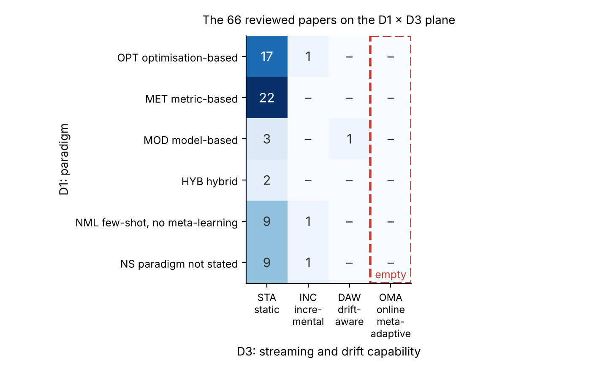
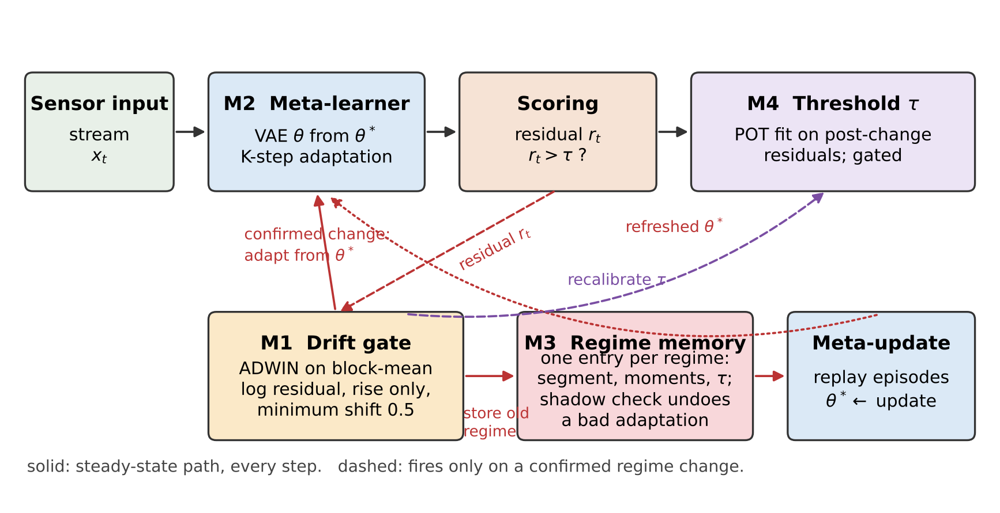
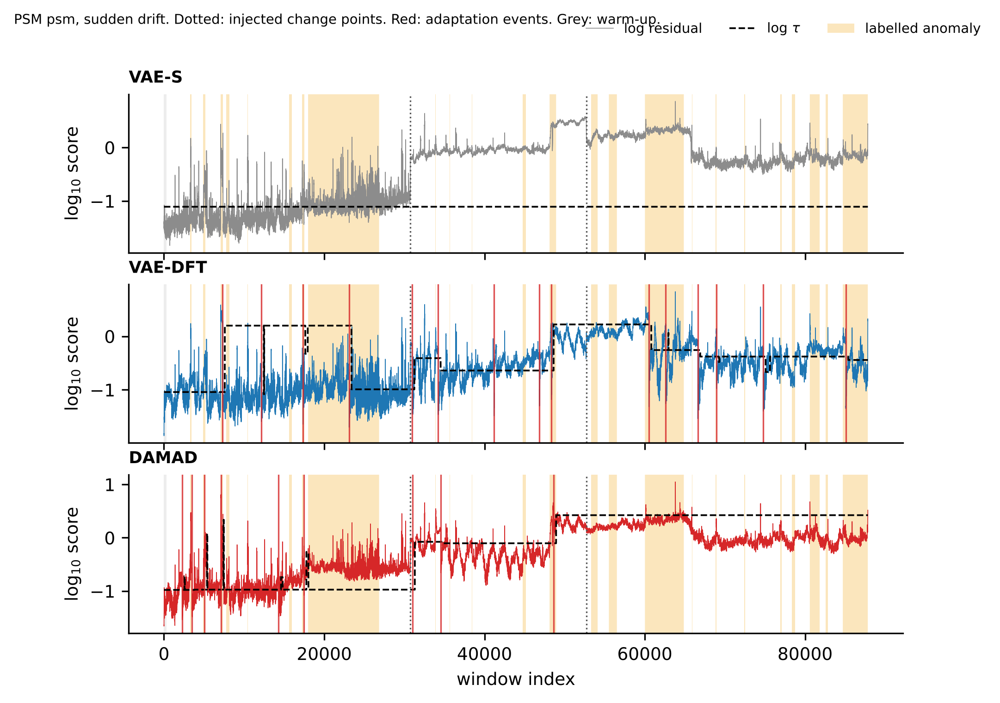
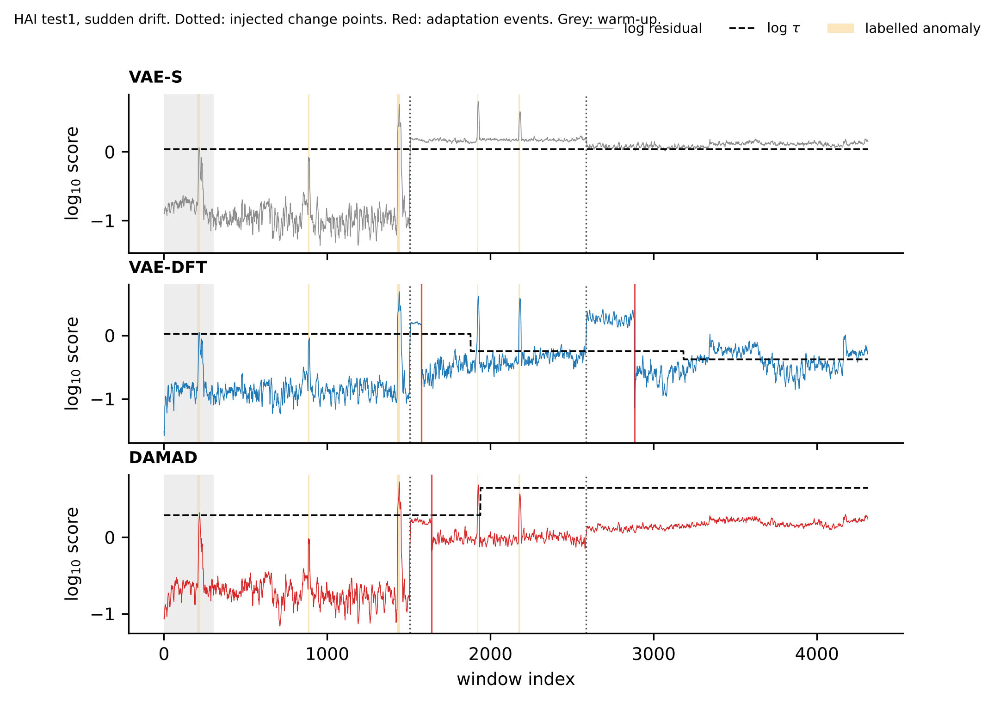

# Abstract {.unnumbered}

Sensor streams from industrial plants have to be watched for faults with almost no labelled examples, under distributions that keep moving, and with new fault types showing up after deployment. Meta-learning is built for the few-shot part of that problem, but a systematic review we carried out of 87 peer-reviewed papers (2018--2025) found no method that combines meta-learning with online adaptation on a non-stationary stream and is evaluated on an industrial benchmark. This paper closes that gap in three steps. First, we condense the review into a four-dimensional taxonomy of meta-learning anomaly detectors and a benchmarking protocol with strictly point-wise metrics, controlled drift injection, and three streaming measures (detection latency, adaptation steps, false-alarm rate under drift). Second, we build DAMAD, the Drift-Aware Meta-Adaptive Detector, as a working system: a MAML++-initialised variational autoencoder that adapts in K gradient steps when a regime change is confirmed, a regime-indexed memory that replays past regimes during meta-updates, a gated extreme-value threshold, and a champion/challenger check that undoes an adaptation if the old model turns out to fit the following data better. Building it changed two design decisions from our earlier conceptual sketch: the drift gate has to watch the model residual rather than the raw input, and a change has to be confirmed by the gain it brings, otherwise long anomalies masquerade as drift. Third, we run DAMAD against eight baselines (Isolation Forest, static, fine-tuned, incrementally updated and drift-aware VAEs, MAML and Meta-SGD adapted once, and an MMD-triggered meta-adapter) on four public benchmarks (HAI 21.03, SMD, SKAB, PSM) over five seeds, four drift patterns and ten ablations, 7,560 streaming runs in all. Without drift, the static VAE is as good as any meta-learned detector, and the number of support windows makes no difference between one and ten: the initialisation is not the bottleneck. Under injected drift the static and adapt-once detectors alarm on 57--75 % of normal steps (up to 100 % on SMD and PSM) and do not recover; DAMAD keeps the rate at 16--25 %, recovers within 190--620 windows, and has the best point-wise F1 under sudden and recurring drift and on SMD under every pattern. On HAI, where the injected shift costs a static threshold less, it brings no gain, and its recalibrated thresholds cost it detection latency everywhere. The ablations show that threshold recalibration and the residual-side gate carry the result, the acceptance test matters where anomalies are long, and replay, the episode sampler and the choice of meta-learner are within seed noise. Code, loaders and every result table are released.

**Keywords:** meta-learning; few-shot learning; anomaly detection; industrial Internet of Things; concept drift; streaming data; variational autoencoder; benchmarking protocol.

# 1 Introduction

Industrial Internet of Things (IIoT) installations stream readings from thousands of sensors, and someone, or something, has to notice when a reading pattern means that a pump is failing, a valve is stuck, or a controller has been tampered with [@chandola2009survey; @pang2021deep]. A missed anomaly costs production time and sometimes equipment or safety. Deep anomaly detection (AD) has produced a long list of methods for this: autoencoders, variational autoencoders [@kingma2014vae], LSTM predictors, adversarial reconstruction [@audibert2020usad] and others, with strong numbers on public benchmarks.

The numbers rely on three assumptions that an IIoT deployment rarely satisfies at once. The first is that labelled faults exist in useful quantity. A turbine that fails once in two years does not provide a training set. The second is that the data distribution is stationary. Equipment ages, loads shift with the season, and operators change set-points, so the statistics of normal operation move [@gama2014drift; @lu2019drift]. The third is that the fault types at deployment time are the ones seen during training. New failure modes appear, and the detector is expected to flag them from a handful of examples. Each problem has its own literature. What is missing is a method, and an evaluation, for the case where all three hold together.

Meta-learning is the natural starting point for the few-shot side. A meta-learner is trained over a distribution of tasks and comes out with an initialisation, an embedding or a memory that adapts to a new task from very little data [@finn2017maml; @snell2017proto; @hospedales2022meta]. Treating each operating regime, or each fault type, as a task makes the application to IIoT straightforward in principle. A few papers have done exactly that [@moon2023mavae; @feng2024metauad; @tian2024omlog]. What we found when we reviewed the field systematically is that the meta-learning methods are trained offline and never updated, the streaming methods do not meta-learn, and almost none of either group is evaluated on an established industrial benchmark.

An earlier version of this work, accepted at PCEMS 2026, reported the review and sketched a conceptual architecture for the empty cell of the resulting taxonomy. It did not build or evaluate it. This paper does. We kept the taxonomy and the review findings, rewrote the protocol around what we learned while running it, and report what it took to make the architecture work on four public datasets.

The contributions are as follows.

1. A four-dimensional taxonomy of meta-learning AD methods (paradigm, detection mechanism, streaming capability, industrial validation) grounded in a PRISMA review of 87 papers, and a gap map showing that the online meta-adaptive column of that taxonomy is empty (Section 3).
2. A benchmarking protocol for this class of methods: open datasets, synthetic drift injected at known change points, strictly point-wise metrics with no point-adjust, three streaming metrics, and a fixed set of baselines and ablations (Section 4).
3. DAMAD, a working online meta-adaptive detector with four modules that each map to one of three sub-problems we identify. Two design choices differ from our earlier sketch, and we explain why with evidence (Section 5).
4. An evaluation on HAI 21.03, SMD, SKAB and PSM, five seeds, four drift patterns, eight baselines and ten ablations, with detection latency, adaptation speed, false-alarm rate under drift and computational cost reported alongside F1 and AUROC (Sections 6 and 7). The results are not uniformly in the method's favour, and we report where they are not.
5. An open implementation in which every method, baseline and ablation is a configuration of one streaming loop, so the comparison is like for like.

The paper is organised as follows. Section 2 gives background on AD, meta-learning and concept drift. Section 3 summarises the systematic review, the taxonomy and the gap map. Section 4 states the three sub-problems and the protocol. Section 5 presents DAMAD. Section 6 describes the experimental setup, Section 7 the results, Section 8 discusses limitations and Section 9 concludes.

# 2 Background

## 2.1 Anomaly detection on multivariate streams

We consider a multivariate stream $x_1, x_2, \dots$ with $x_t \in \mathbb{R}^d$. A detector assigns a score $s(x_t)$ to each step and raises an alarm when $s(x_t) > \tau$. Chandola et al. [@chandola2009survey] distinguish point anomalies (one aberrant reading), contextual anomalies (normal in isolation, aberrant given recent history) and collective anomalies (a sequence that is only aberrant as a whole). Industrial faults are mostly of the last two kinds, which is why detectors work on windows rather than single readings.

The semi-supervised formulation fits IIoT best: train on normal data only, score by departure from learned normality. Reconstruction-based models dominate this formulation. An autoencoder or VAE [@kingma2014vae] learns to reproduce normal windows and scores a window by its reconstruction error,

$$ s(x) = \lVert x - \mathrm{Dec}(\mathrm{Enc}(x)) \rVert^2 \qquad \text{(1)} $$

Every method in that family assumes that the training distribution is the deployment distribution. When it is not, the error in Eq. (1) rises for normal data too, and the model has no way of knowing that it is now wrong [@kermenov2023drift; @wahab2022online].

## 2.2 Meta-learning

Meta-learning makes the learning procedure the object of optimisation [@hospedales2022meta]. Optimisation-based methods learn a parameter initialisation $\theta^*$ from which a few gradient steps on a small support set $S_i$ give a good model for task $T_i$. MAML [@finn2017maml] writes this as an inner step,

$$ \theta_i' = \theta - \alpha \nabla_\theta \mathcal{L}_{S_i}(\theta) \qquad \text{(2)} $$

and an outer step over tasks evaluated on their query sets $Q_i$,

$$ \theta \leftarrow \theta - \beta \nabla_\theta \sum_i \mathcal{L}_{Q_i}(\theta_i') \qquad \text{(3)} $$

MAML++ [@antoniou2019mamlpp] stabilises this with per-layer, per-step inner learning rates and a multi-step query loss; Meta-SGD [@li2017metasgd] learns a per-parameter inner learning rate; first-order variants [@nichol2018fomaml] drop the second derivative in Eq. (3). Because the learner can be any differentiable model, an autoencoder works as the base learner, which is what makes optimisation-based meta-learning the right paradigm for reconstruction-based AD. Metric-based methods [@snell2017proto] learn an embedding in which a query is classified by distance to class prototypes; model-based methods use an external memory and adapt with a forward pass. Both are cheap at inference time but, as Section 3 shows, neither has been combined with streaming adaptation.

## 2.3 Concept drift

A stream exhibits concept drift when the joint distribution of readings and labels at time $t$ differs from that at $t + \Delta t$ [@gama2014drift; @lu2019drift]. Four patterns are usually distinguished: sudden, gradual (the two regimes are mixed over a transition period), incremental (a slow monotone shift) and recurring (earlier regimes return). Detection methods fall into three classes. Error-rate monitors such as DDM [@gama2004ddm] need labelled feedback and are out of reach in unsupervised AD. Distribution monitors such as ADWIN [@bifet2007adwin] watch a statistic of the stream and come with bounds on false positives and false negatives. Representation monitors watch the model's own internal state, for example by comparing kernel embeddings with maximum mean discrepancy (MMD) [@gretton2012mmd]. Hinder et al. survey detection and adaptation in detail [@hinder2024a; @hinder2024b]. Continual learning supplies the tools for updating a model without forgetting what it knew [@kirkpatrick2017ewc; @rolnick2019replay; @wang2024continual]; the connection to meta-learning, where a distribution shift becomes a change of task distribution, is the one this paper exploits.

# 3 Systematic review and taxonomy

## 3.1 Method

The review followed the PRISMA 2020 guidelines [@page2021prisma]. We searched IEEE Xplore, Scopus, Web of Science, the ACM Digital Library and Google Scholar for January 2018 to December 2025, the period since MAML [@finn2017maml] started the current wave of gradient-based meta-learning. Two search strings were used. The primary string targeted the intersection of meta-learning and AD: ("meta-learning" OR "few-shot learning" OR "MAML" OR "prototypical network" OR "learning to learn") AND ("anomaly detection" OR "fault detection" OR "outlier detection") AND ("Internet of Things" OR "IoT" OR "IIoT" OR "streaming data" OR "time series" OR "industrial"). The secondary string captured concept drift and AD jointly: ("concept drift" OR "distribution shift" OR "non-stationary" OR "online learning") AND ("anomaly detection" OR "fault detection") AND ("IoT" OR "IIoT" OR "streaming" OR "industrial").

Table 1 lists the inclusion and exclusion criteria and Table 2 the four-stage selection. Pooling both strings across the five databases gave 1,247 records, 834 after de-duplication. Title and abstract screening removed 636 (271 with no meta-learning/AD intersection, 214 image-domain only, 151 outside the date or language limits), leaving 198. Full-text review removed a further 124 (51 without a methodological contribution, 47 treating the two topics in isolation, 26 not peer-reviewed), leaving 74. Backward and forward citation chaining added 13. The final corpus is 87 papers. Nine were published in 2018--19, 17 in 2020--21, 31 in 2022--23 and 30 in 2024--25, so roughly 70 % of the corpus is from 2022 onwards.

Table 1. Inclusion (IC) and exclusion (EC) criteria.

| Code | Criterion |
|---|---|
| IC1 | Addresses meta-learning or few-shot learning in the context of anomaly or fault detection |
| IC2 | Published January 2018 to December 2025 |
| IC3 | Indexed in Scopus or Web of Science; peer-reviewed; English; full text available |
| EC1 | Meta-learning or AD alone, with no meaningful intersection |
| EC2 | Image-based AD only, with no applicability to time series or sensor streams |
| EC3 | Applies existing methods with no methodological contribution to either topic |
| EC4 | Not peer-reviewed: preprints, workshop papers without formal review, duplicated submissions |

Table 2. PRISMA selection summary.

| Stage | Outcome |
|---|---|
| 1. Identification (5 databases) | 1,247 records; 834 after removing 413 duplicates |
| 2. Title and abstract screening | 198 retained; 636 excluded |
| 3. Full-text eligibility | 74 retained; 124 excluded |
| 4. Citation chaining | 13 added |
| Final corpus | 87 papers |

## 3.2 A four-dimensional taxonomy

Earlier surveys classify AD methods along one axis, usually algorithm family [@chandola2009survey; @pang2021deep] or application domain [@belay2023iot]. One axis hides trade-offs that matter here: a method can be excellent at few-shot adaptation and completely static, or drift-aware and never tested on industrial hardware. We classify every paper in the corpus along four axes at once.

*D1, meta-learning paradigm.* OPT: optimisation-based, learning a shared initialisation (MAML, MAML++, Meta-SGD). MET: metric-based, learning a task-agnostic embedding. MOD: model-based, using memory or recurrent architectures. HYB: two or more of the above.

*D2, detection mechanism.* REC: reconstruction error (AE, VAE). DIS: distance to learned prototypes. DEN: density estimation. PRE: prediction error. HYB: a combination.

*D3, streaming and drift capability.* STA: trained offline, no online update. INC: incremental updates without explicit drift awareness. DAW: detects distribution shift and triggers adaptation. OMA: online meta-adaptive, meaning the meta-level itself (the initialisation or the task distribution) is updated as the stream evolves.

*D4, industrial validation.* IIV: evaluated on an established industrial process benchmark (SWaT [@goh2016swat], WADI [@ahmed2017wadi], HAI [@shin2021hai], SMAP/MSL [@hundman2018smap]). IOV: evaluated on broader IoT or network data. GEN: generic datasets. THE: theory or simulation only.

Table 3 places representative papers on the grid, and Figure 1 plots the whole corpus on the D1 × D3 plane. Optimisation-based methods account for 48 of the 87 papers (55 %), metric-based for 27 (31 %), model-based for 10 (11 %) and hybrid for 2 (2 %).

Table 3. Taxonomy placement of representative papers.

| Paper | Year | D1 | D2 | D3 | D4 |
|---|---|---|---|---|---|
| Finn et al. [@finn2017maml] | 2017 | OPT/MAML | n/a | STA | GEN |
| Moon et al. [@moon2023mavae] | 2023 | OPT/MAML | REC (VAE) | STA | GEN |
| Feng et al. [@feng2024metauad] | 2024 | OPT/Meta-SGD | DIS | STA | IOV |
| Tian et al. [@tian2024omlog] | 2024 | MOD | PRE | DAW | GEN |
| Wahab [@wahab2022online] | 2022 | none | PRE | INC | IOV |
| Zhang et al. [@zhang2023prn] | 2023 | MET | DIS | STA | GEN |
| Kermenov et al. [@kermenov2023drift] | 2023 | none | REC | INC | IIV |
| Belay et al. [@belay2023iot] | 2023 | none | REC+DIS | STA | IIV |
| Yan et al. [@yan2024fewshot] | 2024 | MET | DIS | STA | IOV |
| DAMAD (this work) | 2026 | HYB | REC | OMA | IIV |

{#fig:gapmap width=85%}

## 3.3 Three findings

*Finding 1, static dominance.* Most papers in every paradigm sit in the STA column. Methods designed for offline training are being applied to a problem that is online by nature.

*Finding 2, the OMA gap.* No paper in the corpus updates its meta-learning strategy in response to stream evolution. The column is empty for all four paradigms and for all eight years.

*Finding 3, the validation gap.* The papers that use SWaT, WADI, HAI or SMAP/MSL do not meta-learn; the papers that meta-learn do not use them. The only datasets on which meta-learning AD has been reported are network traffic (CIC-IDS [@feng2024metauad]) and software logs (HDFS/BGL [@tian2024omlog]).

Two papers deserve mention because they come closest. MAVAE [@moon2023mavae] wraps a VAE in a MAML outer loop and shows that five labelled normal windows suffice to adapt to a new sensor type. It is trained offline and never updated. OMLog [@tian2024omlog] uses MMD on log-sequence embeddings to detect a shift and then runs few-shot meta-adaptation; it is the only DAW method in the corpus, but it is built for discrete log sequences and has no memory of past regimes and no threshold management. Our baselines MAML-1 and OML-A (Section 6) transfer these two ideas to sensor streams so that they can be compared with DAMAD directly.

# 4 Problem statement and benchmarking protocol

## 4.1 Three sub-problems

Achieving the OMA capability requires solving three sub-problems that the corpus does not solve together.

*SP1, drift-aware episode construction.* Episodic meta-learning samples support and query sets that should come from one coherent task. In a non-stationary stream, naive temporal sampling mixes pre- and post-change observations into the same episode and destabilises the inner loop. The sampler has to know where one regime ends and the next begins.

*SP2, online meta-initialisation update without forgetting.* The initialisation $\theta^*$ must keep up with the stream if it is to remain a useful starting point, but updating it on the newest regime alone overwrites what it knew about earlier regimes. This is catastrophic forgetting at the meta level [@kirkpatrick2017ewc].

*SP3, threshold recalibration under drift without labels.* Drift and anomalies both raise the reconstruction error. Only one of them should move the threshold $\tau$. Telling the two apart, and recalibrating $\tau$ in the right case only, has to be done without labels at deployment time.

## 4.2 Evaluation problems in the reviewed work

Two evaluation practices make cross-paper comparison unreliable. The first is point-adjust scoring, under which one true positive anywhere inside an anomalous segment counts the whole segment as detected. Point-adjust F1 can sit 15--30 points above point-wise F1 on the same scores, and a random scorer can reach high point-adjust F1 on long segments [@kim2022rigorous; @garg2022evaluation; @wu2023flawed]. The second is that no reviewed paper reports a streaming metric: how long detection takes, how fast the detector recovers after a change, or how many false alarms the change itself causes.

## 4.3 The protocol

Table 4 states the protocol we use in Sections 6 and 7. It differs from the version in our PCEMS paper in two respects. SWaT and WADI are licence-gated by iTrust and SMAP/MSL were not reachable from our build environment, so the mandatory tier is now the set of openly downloadable industrial and server benchmarks, with SWaT/WADI/SMAP/MSL as an optional tier the loader supports. And the drift injection is specified exactly, so that every method sees the same stream.

Table 4. The benchmarking protocol.

| Element | Specification |
|---|---|
| Datasets | Mandatory: HAI 21.03 (ICS testbed), SMD (server machines), SKAB (rotating-machinery rig), PSM (server metrics). Optional: SWaT, WADI, SMAP, MSL. |
| Few-shot setting | Held-out entities (machines, runs, campaigns) never seen in meta-training; K ∈ {1, 5, 10} support windows at the start of each stream. |
| Drift injection | Affine per-sensor shift on a random half of the sensors (offset 1.5 training standard deviations, scale factor 1.3) applied after change points at 35 % and 60 % of the stream (sudden, gradual with a 5 % transition, recurring with a third point at 80 %), or growing linearly over 30 % of the stream (incremental). Labels unchanged. |
| AD metrics | Precision, recall and F1 at the method's own deployed threshold, strictly point-wise; AUROC and AUPRC threshold-free. Point-adjust is prohibited. Oracle-threshold F1 may be reported for context only. |
| Streaming metrics | Detection latency (steps from segment onset to the first alarm inside it); adaptation steps (steps after a change point until the rolling false-alarm rate returns to the pre-drift level plus 5 points); false-alarm rate on normal steps after the first change point. |
| Warm-up | The first K + 300 windows (K + 100 on SKAB) are used for adaptation and threshold calibration by every method and excluded from scoring. |
| Threshold | Peaks-over-threshold [@siffer2017pot] at risk q = 10^-2^ for every method, so that threshold selection is not a confound. |
| Baselines | Isolation Forest, static VAE, fine-tuned VAE, incrementally updated VAE, drift-aware fine-tuned VAE, MAML-adapted-once VAE, Meta-SGD-adapted-once VAE, MMD-triggered meta-adapter. |
| Statistics | Mean ± standard deviation over five seeds; the seed also changes the entity split. |
| Ablations | Each module removed or replaced in isolation. |
| Cost | Scoring time per window, adaptation time, meta-update time, memory footprint, parameter count. |

# 5 DAMAD

## 5.1 Overview

DAMAD has four modules arranged around a streaming VAE (Figure 2). In steady state every window $x_t$ is encoded, reconstructed and scored by Eq. (1), and an alarm is raised if the score exceeds $\tau$. Module 1 watches the residual for a regime change. When a change is confirmed, the next K windows become the support set, Module 2 adapts a fresh copy of $\theta^*$ to them in K gradient steps, Module 4 recalibrates $\tau$ on the residuals that follow, Module 3 stores the regime that just ended, and a replay meta-update refreshes $\theta^*$ from the new regime and a few remembered ones. A champion/challenger check runs in parallel for a while: the previous model keeps scoring in the shadow, and if it fits the stream better than the adapted one, the adaptation and the new threshold are undone.

{#fig:arch width=100%}

## 5.2 Module 2: the meta-learned VAE

The base learner is an MLP VAE on flattened windows of W = 8 steps, so the input dimension is $8d$. The encoder has two hidden layers (128 and 64 units, ELU) producing a 16-dimensional Gaussian posterior; the decoder mirrors it. The training loss is the negative ELBO with the KL term weighted by $\beta = 0.1$; the anomaly score is the mean squared reconstruction error through the posterior mean, which is deterministic.

Meta-training follows MAML++ [@antoniou2019mamlpp]. A task is a regime (Section 5.3). An episode draws K support windows from the first half of the regime and 32 query windows from the second half, so that the inner loop cannot see the query steps. Three inner steps are taken with learnable per-layer, per-step learning rates, and the outer loss is a weighted sum of the query loss after each inner step, annealed over the first 200 outer iterations towards the final step only. We use the first-order approximation [@nichol2018fomaml]; for a model of this size on CPU the second-order term buys little. The inner gradient is clipped to norm 10 before the step. Without the clipping a support set that happens to hold a few windows at the edge of the clipping range throws the adapted parameters far away and meta-training diverges, which is what happened in our first runs. Meta-training runs 400 outer iterations with a meta-batch of four regimes and Adam at $10^{-3}$. At deployment, adaptation is the same three inner steps from $\theta^*$ on the K support windows.

## 5.3 Module 1: regime boundaries and the drift gate

Module 1 has two jobs: cutting the training streams into regimes for episode construction (SP1), and deciding online when the deployed model should adapt.

*Training-time segmentation.* One ADWIN [@bifet2007adwin] runs per sensor on block means of ten steps. A regime boundary is placed when at least 20 % of the sensors have reported a change within the last 200 steps and the current regime is at least 400 steps long. Over-segmentation only costs episode diversity, so the vote is permissive. On SMD this yields 870 regimes with a median length of 400 steps from 20 training machines. The ablations replace this sampler with fixed chunks of the same median length and with regime-free random sampling.

*Online gate.* Our PCEMS sketch ran ADWIN on the raw input with MMD on the embeddings as a second detector. Neither survived contact with real streams in that form. On server and process data the input statistics never stop moving, so a gate that fires on input change adapts every few hundred steps whether or not the model has stopped fitting. The quantity that matters is whether the model still fits. The gate therefore runs ADWIN on block means (ten windows) of the log residual, and only changes in which the retained window has the higher mean count, because a model that fits better than before needs no adaptation. The change must also be material: the retained mean has to exceed the level recorded after the last adaptation by at least 0.5 log units, a 65 % rise in residual. One such hit confirms a change; the block mean, the direction rule and the minimum shift already guard against spikes. A refractory period of 400 windows separates adaptations.

We also implemented the MMD branch [@gretton2012mmd]: the kernel two-sample statistic between the encoder embeddings of the last 64 windows and 300 reference embeddings recorded after the last adaptation, with a block-bootstrap null (the largest MMD² between any contiguous 64-window block of the reference set and the rest of it, times 1.5) and two consecutive exceedances required. Even with that conservative null it over-triggers on ordinary within-regime variation, and every adaptation it causes costs a fresh threshold calibration on a short window. Section 7.4 reports the variants with MMD alone and with both detectors; the full method uses the residual gate only.

## 5.4 Module 4: gated threshold

$\tau$ is set by the peaks-over-threshold method [@siffer2017pot]: a generalised Pareto distribution is fitted to the residual excesses above the 98th empirical percentile of a calibration window and $\tau$ is the quantile of that tail at risk $q = 10^{-2}$. The calibration window is the 300 windows that follow adaptation (100 on SKAB). Between confirmed changes $\tau$ does not move, whatever the residual does in the short term. This is the gating that keeps the false-alarm rate in check during ordinary stream variation and it is the same procedure for every method in the study, so the comparison does not reward one method's threshold heuristics over another's.

## 5.5 Module 3: regime memory and replay

The buffer holds one entry per regime: the last 300 steps of the regime, its per-sensor mean and variance, and the $\tau$ that was in force. Capacity is eight regimes; the oldest leaves first. After an adaptation has been accepted, $\theta^*$ is refreshed by ten outer iterations of the meta-learner on episodes drawn from the current regime and up to three remembered regimes, sampled with probability proportional to a similarity term (closeness of the regime means) plus a recency bonus. This is experience replay [@rolnick2019replay] at the level of regimes rather than records, which keeps the buffer at a few hundred kilobytes.

## 5.6 The acceptance test

The three sub-problems interact through one confound: a long anomaly raises the residual, so it can confirm a change, and the detector will then adapt to the anomaly and calibrate $\tau$ on it. When normal operation resumes, the adapted model fits it worse than the old one did, and false alarms flood in. We observed exactly this on SMD, where anomaly segments can last several hundred steps. The remedy is to make the decision falsifiable. After adaptation and recalibration, the previous model and its threshold are kept as a champion for 600 windows (200 on SKAB) while the adapted model scores. Every 50 windows the rolling medians of the two log residuals are compared; if the champion is better by more than 0.1 log units, the adaptation, the new $\tau$ and the memory entry are undone. A first check at the end of the calibration window catches the obvious cases early. The idea has a precedent in paired learners for concept drift [@bach2008paired], where a stable and a reactive learner compete. Here the competition decides whether the thing that moved was the regime or an anomaly, which is SP3 stated operationally.

## 5.7 Cost

In steady state DAMAD does one forward pass per window plus O(log n) ADWIN work per ten windows. During the shadow period a second forward pass is added. Adaptation costs three gradient steps on K windows; a replay meta-update costs ten outer iterations on four episodes. The buffer holds at most eight regimes × 300 steps × d floats. Section 7.6 reports the measured figures.

## 5.8 Placement in the taxonomy

DAMAD is HYB on D1 (an optimisation-based initialisation with a model-based memory), REC on D2, OMA on D3 because $\theta^*$ itself is updated at deployment time, and IIV on D4 because it is evaluated on HAI and on the server benchmarks in Section 6. To our knowledge it is the first method evaluated in that cell.

# 6 Experimental setup

## 6.1 Datasets and entities

Table 5 lists the datasets. An *entity* is one monitored unit with a normal-only training stream and a labelled test stream, and it is the unit of the few-shot split: a held-out entity is one the meta-learner never saw. Values are standardised with the entity's own training statistics and clipped to ±10 standard deviations; without the clipping a sensor that barely moves in training turns ordinary test noise into values in the thousands.

*HAI 21.03* [@shin2021hai] comes from a hardware-in-the-loop testbed with a boiler, a turbine and a water-treatment process, 79 tags at 1 Hz, three attack-free training campaigns and five test campaigns with labelled attacks. We average the signals over 10-second blocks, pool the training campaigns (keeping them as separate streams for regime segmentation, since they were recorded weeks apart) and treat each test campaign as an entity. *SMD* [@su2019omnianomaly] has 28 server machines with 38 metrics at one-minute resolution; each machine is an entity, and 30 % of the machines are held out per seed. *SKAB* [@katser2020skab] is a water-circulation rig with 8 sensors at 1 Hz and 34 short runs in which a valve or the pump is manipulated. The anomaly-free recording sits at a very different flow level from most runs, so each run is standardised with its own normal prefix, which becomes its training stream; one run with almost no prefix is dropped, and 30 % of runs are held out per seed. This makes SKAB a genuine few-shot setting: the detector meets a new run with a few hundred seconds of normal operation. *PSM* [@abdulaal2021psm] is a single stream of 25 server metrics; regimes for meta-training are carved from its training part, and its test part is the held-out stream.

Table 5. Datasets. Test lengths are in windows after preprocessing; anomaly rate is the share of labelled steps.

| Dataset | Domain | d | Entities (held out) | Test length | Anomaly rate | Sampling |
|---|---|---|---|---|---|---|
| HAI 21.03 | ICS testbed | 79 | 5 (5) | 4k--12k | 1.4--2.9 % | 10 s (block mean) |
| SMD | servers | 38 | 28 (8) | 24k--29k | 4.2 % avg. | 1 min |
| SKAB | rotating machinery | 8 | 33 (10) | 0.9k--1.2k | 35 % avg. | 1 s |
| PSM | servers | 25 | 1 (1) | 88k | 28 % | 1 min |

## 6.2 Methods

Every method runs through the same streaming loop and differs only in configuration (Table 6). All VAE-based methods share the architecture of Section 5.2. The static VAE is trained for 1,500 Adam steps on 60,000 pooled normal windows from the meta-training entities. Meta-learners are trained as in Section 5.2 on regimes from the meta-training entities. Isolation Forest uses 100 trees on 20,000 pooled windows. Every method calibrates its threshold with the same POT procedure on the same warm-up windows.

Table 6. Methods. "adapt once" means K-shot adaptation at the start of the stream and nothing after.

| Name | Initialisation | Reaction to drift | Gate | Replay | τ recalibration |
|---|---|---|---|---|---|
| IF | Isolation Forest | none | – | – | – |
| VAE-S | static VAE | none | – | – | – |
| VAE-FT | static VAE | fine-tune once (30 Adam steps on K windows) | – | – | – |
| VAE-INC | static VAE | one Adam step every 5 windows on the last 32 non-alarmed windows [@wahab2022online] | – | – | – |
| VAE-DFT | static VAE | fine-tune on K post-change windows | residual ADWIN, acceptance test | – | yes |
| MAML-1 | MAML++ θ* | adapt once [@moon2023mavae] | – | – | – |
| MSGD-1 | Meta-SGD θ* | adapt once | – | – | – |
| OML-A | MAML++ θ* | K-step adapt on change [@tian2024omlog] | MMD | – | – |
| DAMAD | MAML++ θ* | K-step adapt on change | residual ADWIN, acceptance test | yes | yes |

VAE-DFT shares DAMAD's gate, acceptance test and recalibration and differs only in adapting from the static initialisation by fine-tuning; it therefore isolates the contribution of the meta-learned initialisation. OML-A differs from DAMAD in using MMD on the embeddings as its only gate and in having no memory, no recalibration and no acceptance test, which is the OMLog recipe.

The ablations (Table 7) remove or replace one element of DAMAD at a time.

Table 7. Ablations.

| Variant | Change |
|---|---|
| DAMAD-rndM1 | episodes drawn from anywhere in the training stream, no regime boundaries |
| DAMAD-noM1 | episodes from fixed chunks of the median ADWIN-regime length |
| DAMAD+mmd | residual ADWIN and MMD both as the gate (the PCEMS sketch) |
| DAMAD-mmd | MMD only as the gate |
| DAMAD-noM3 | no replay meta-update |
| DAMAD-noM4 | threshold never recalibrated after the initial calibration |
| DAMAD-noAcc | no acceptance test |
| DAMAD-fo | FOMAML initialisation (single inner learning rate, no multi-step loss) |
| DAMAD-msgd | Meta-SGD initialisation |

## 6.3 Conditions, metrics and implementation

Each held-out entity of HAI, SMD and PSM is run under five stream conditions: its original test stream and the four injected-drift versions of Table 4. SKAB runs are about a thousand windows long, which is not enough to hold a 100-window calibration, a 200-window shadow period and a refractory period between two injected changes, so SKAB is used for the few-shot cold-start setting only. Ablations are scored under the drift conditions. The few-shot sweep (K = 1, 5, 10) is run on the original streams for the methods that adapt at the start; all drift conditions use K = 5. Metrics are those of Table 4. Detection latency is averaged over anomaly segments in which an alarm occurred, and the share of segments with any alarm is reported next to it. Adaptation steps use a rolling window of 100 steps and are capped at the length of the post-change segment if the rate never recovers.

Everything is implemented in PyTorch 2 and NumPy and runs on CPU; one seed of the whole study takes about an hour per dataset on a four-core machine with one thread per job. Reported timings come from that machine. Five seeds change the network initialisation, the episode sampling, the drift realisation and the entity split.

# 7 Results

All numbers are means ± standard deviations over five seeds, where each seed's value is first averaged over the held-out entities of a dataset. The complete tables, including per-dataset versions of every pooled table, are in the repository; the ones reproduced here are the ones the text refers to. In total 7,560 streaming runs were scored.

## 7.1 Few-shot cold start without injected drift

Table 8 gives point-wise F1 at each method's own threshold and AUROC on the original test streams with K = 5. Two things stand out. The AUROC column is almost flat across every VAE-based method on every dataset: 85--87 % on SKAB, 82--87 % on SMD, 69--78 % on PSM, 94--95 % on HAI. The ranking of the raw scores does not depend much on how the model was initialised or whether it adapts. What differs is F1, and F1 is decided by the threshold and by what the detector does after the first 300 windows.

Table 8. Cold start on held-out entities, no injected drift, K = 5. Point-wise F1 (%) at the deployed threshold and AUROC (%). Best per column in bold.

| Method | SKAB F1 | SMD F1 | PSM F1 | HAI F1 | SKAB AUROC | SMD AUROC | PSM AUROC | HAI AUROC |
|---|---|---|---|---|---|---|---|---|
| IF | 16.0 ± 4.7 | 18.3 ± 6.6 | 46.0 ± 1.9 | 9.1 ± 4.1 | **86.8 ± 4.6** | 79.7 ± 2.2 | 69.1 ± 2.4 | 73.0 ± 1.8 |
| VAE-S | 64.1 ± 5.9 | 29.4 ± 5.1 | **59.3 ± 2.1** | **32.7 ± 3.9** | 85.3 ± 3.0 | 84.1 ± 3.9 | **77.7 ± 0.9** | **94.9 ± 0.1** |
| VAE-FT | **65.6 ± 6.0** | 28.7 ± 4.6 | 52.4 ± 2.1 | 32.2 ± 4.0 | 86.7 ± 3.5 | 84.6 ± 4.7 | 73.3 ± 1.6 | 94.2 ± 0.2 |
| VAE-INC | 53.7 ± 2.4 | **32.9 ± 6.3** | 38.6 ± 0.7 | 31.1 ± 2.2 | 80.2 ± 3.0 | **86.7 ± 3.2** | 57.6 ± 0.9 | 94.8 ± 0.2 |
| VAE-DFT | 42.7 ± 6.4 | 29.4 ± 3.2 | 43.5 ± 9.0 | 32.1 ± 4.5 | 75.2 ± 3.1 | 81.8 ± 3.8 | 70.6 ± 3.6 | 94.3 ± 0.2 |
| MAML-1 | 64.1 ± 4.9 | 26.1 ± 5.3 | 52.6 ± 0.9 | 21.7 ± 1.0 | 85.8 ± 3.1 | 84.4 ± 4.5 | 76.3 ± 1.5 | 93.8 ± 0.4 |
| MSGD-1 | 64.0 ± 5.1 | 26.6 ± 4.5 | 53.6 ± 2.6 | 21.6 ± 0.4 | 85.8 ± 3.0 | 84.6 ± 4.3 | 75.3 ± 0.4 | 93.6 ± 0.2 |
| OML-A | 62.8 ± 4.5 | 27.0 ± 5.2 | 52.6 ± 1.6 | 23.5 ± 1.4 | 85.4 ± 3.0 | 84.6 ± 4.1 | 75.7 ± 2.0 | 94.2 ± 0.4 |
| DAMAD | 54.9 ± 4.8 | 29.4 ± 3.5 | 46.7 ± 14.5 | 25.7 ± 5.0 | 85.8 ± 3.1 | 82.9 ± 4.5 | 69.4 ± 6.3 | 94.1 ± 0.1 |

Without drift, the static VAE is as good as anything else and better than the meta-learned detectors on PSM and HAI. The meta-learned initialisation adapted once (MAML-1, MSGD-1) does not beat it on any dataset; on HAI it is 11 points behind, because its threshold, calibrated right after a five-window adaptation, ends up higher than the static one and recall suffers (precision 0.65 versus 0.72, recall 0.33 versus 0.39). DAMAD sits between the two groups. On SMD it matches the static VAE's F1 with less than half the false-alarm rate (8.0 % versus 17.8 % of normal steps) and higher precision (0.30 versus 0.27); on SKAB and PSM it trades recall for precision (SKAB: precision 0.87 versus 0.80, recall 0.44 versus 0.62). The SKAB result has a specific cause. SKAB faults persist to the end of the run, the gate fires on the fault onset in 72 % of runs, and the adaptation that follows fits the fault; the acceptance test cannot undo it because the pre-fault regime never comes back. This is the SP3 confound in its worst case and no unsupervised rule resolves it. On PSM the high standard deviation (± 14.5) comes from one seed in which an early adaptation on a contaminated calibration window set a threshold the detector did not recover from.

Table 9 shows F1 against the number of support windows. The lines are flat: on no dataset does going from one to ten support windows move any method by more than two points, and on SKAB and HAI the adapt-once meta-learners sit on or below the static VAE at every K. The meta-learned initialisation is not the bottleneck in this problem. Five windows of a new entity are enough for any of these initialisations to reach the quality the small VAE can reach; what is left is the question of what to do afterwards.

Table 9. F1 (%) versus support-set size K on the original test streams.

| Method | SKAB 1 | SKAB 5 | SKAB 10 | SMD 1 | SMD 5 | SMD 10 | PSM 1 | PSM 5 | PSM 10 | HAI 1 | HAI 5 | HAI 10 |
|---|---|---|---|---|---|---|---|---|---|---|---|---|
| VAE-S | 64.2 | 64.1 | 63.6 | 29.4 | 29.4 | 29.4 | 59.3 | 59.3 | 59.3 | 32.7 | 32.7 | 32.7 |
| VAE-FT | 66.7 | 65.6 | 64.3 | 28.3 | 28.7 | 28.4 | 52.1 | 52.4 | 52.4 | 33.8 | 32.2 | 31.0 |
| MAML-1 | 64.1 | 64.1 | 63.2 | 26.3 | 26.1 | 26.2 | 53.3 | 52.6 | 51.5 | 22.4 | 21.7 | 21.2 |
| MSGD-1 | 64.2 | 64.0 | 63.2 | 26.8 | 26.6 | 26.7 | 53.3 | 53.6 | 52.7 | 22.1 | 21.6 | 21.1 |
| OML-A | 63.2 | 62.8 | 62.3 | 26.7 | 27.0 | 26.8 | 53.4 | 52.6 | 51.0 | 23.6 | 23.5 | 23.9 |
| DAMAD | 54.7 | 54.9 | 55.2 | 30.2 | 29.4 | 29.2 | 33.3 | 46.7 | 45.6 | 26.3 | 25.7 | 25.5 |

{#fig:shots width=100%}

## 7.2 Streaming drift

Tables 10 to 12 report the drift conditions on SMD, PSM and HAI with K = 5, pooled and per dataset, and Figure 4 plots the pooled F1 and false-alarm rate. The false-alarm rate after the first change point (Table 11) is where the methods separate. Pooled over the three datasets, the static VAE alarms on 57--75 % of normal steps after a change; the meta-learned detectors adapted once do the same (58--68 %), and OML-A, which adapts on an MMD trigger but never moves its threshold, is barely better (54--63 %). On SMD and PSM the static group is at 73--100 %. These detectors have not failed to see the anomalies; they have stopped being able to say anything, because almost every step is above the threshold that was set in the first regime. The incrementally updated VAE sits in the middle (24--61 %), and is the best method under incremental drift, where a slow shift is exactly what one optimiser step every five windows can follow. The two drift-aware methods are the only ones that keep the rate low in every condition: 23--31 % for VAE-DFT and 16--25 % for DAMAD.

Table 10. Point-wise F1 (%) by drift condition, K = 5. "none" is the original stream. Pooled rows average SMD, PSM and HAI; SKAB is excluded from the drift conditions (Section 6.3).

| Method | pooled none | pooled sudden | pooled gradual | pooled incr. | pooled recur. | SMD sudden | SMD gradual | SMD incr. | SMD recur. |
|---|---|---|---|---|---|---|---|---|---|
| IF | 16.6 ± 3.6 | 11.3 ± 2.4 | 11.1 ± 2.2 | 11.2 ± 2.3 | 11.7 ± 2.8 | 11.2 ± 4.1 | 10.9 ± 3.7 | 11.5 ± 4.4 | 11.9 ± 4.6 |
| VAE-S | **45.8 ± 4.2** | 18.6 ± 2.0 | 17.9 ± 2.2 | 18.6 ± 2.2 | 19.3 ± 2.2 | 9.3 ± 3.7 | 9.6 ± 3.8 | 10.2 ± 3.7 | 10.7 ± 3.7 |
| VAE-FT | 45.8 ± 3.1 | 18.5 ± 2.3 | 17.8 ± 2.4 | 18.5 ± 2.8 | 19.1 ± 2.4 | 10.1 ± 4.2 | 10.1 ± 3.9 | 10.9 ± 4.2 | 11.5 ± 4.2 |
| VAE-INC | 41.4 ± 2.3 | 17.0 ± 1.6 | **23.1 ± 3.3** | **25.7 ± 2.3** | 20.5 ± 3.8 | 11.1 ± 4.0 | 18.2 ± 5.0 | **23.9 ± 4.1** | 14.0 ± 6.1 |
| VAE-DFT | 36.1 ± 3.0 | 19.7 ± 3.8 | 20.2 ± 3.2 | 21.3 ± 2.2 | 21.7 ± 4.7 | 21.9 ± 5.7 | 19.6 ± 4.6 | 16.8 ± 4.1 | 22.0 ± 7.1 |
| MAML-1 | 42.1 ± 3.3 | 20.1 ± 2.2 | 20.1 ± 3.3 | 17.5 ± 2.3 | 20.8 ± 3.2 | 10.1 ± 4.0 | 10.4 ± 4.2 | 11.1 ± 4.2 | 11.3 ± 4.0 |
| MSGD-1 | 42.3 ± 3.4 | 18.8 ± 2.9 | 18.6 ± 5.0 | 17.3 ± 2.3 | 20.4 ± 3.7 | 11.0 ± 5.2 | 11.1 ± 5.2 | 11.1 ± 4.2 | 11.9 ± 4.8 |
| OML-A | 42.2 ± 3.1 | 20.8 ± 2.1 | 20.2 ± 3.4 | 19.5 ± 2.7 | 21.0 ± 3.3 | 10.7 ± 4.2 | 10.7 ± 4.4 | 11.5 ± 4.9 | 11.8 ± 4.1 |
| DAMAD | 40.0 ± 3.8 | **24.3 ± 2.5** | 23.0 ± 3.5 | 20.0 ± 1.3 | **26.5 ± 2.5** | **24.6 ± 5.8** | **20.3 ± 1.3** | 21.2 ± 1.7 | **23.9 ± 4.4** |

Table 11. False-alarm rate (%) on normal steps after the first change point, K = 5. Lower is better.

| Method | pooled sudden | pooled gradual | pooled incr. | pooled recur. | SMD sudden | SMD recur. | PSM sudden | PSM recur. | HAI sudden | HAI recur. |
|---|---|---|---|---|---|---|---|---|---|---|
| IF | 71.0 ± 3.2 | 67.5 ± 3.6 | 68.5 ± 5.5 | 56.1 ± 5.5 | 77.8 ± 2.4 | 64.2 ± 5.0 | 97.7 ± 4.1 | 82.6 ± 7.7 | 54.8 ± 5.7 | 37.9 ± 11.8 |
| VAE-S | 74.1 ± 3.1 | 71.9 ± 3.2 | 65.2 ± 2.7 | 57.2 ± 2.1 | 94.3 ± 5.8 | 73.3 ± 3.7 | 100.0 ± 0.0 | 92.1 ± 0.8 | 36.4 ± 5.1 | 24.6 ± 6.2 |
| VAE-FT | 75.0 ± 3.1 | 72.3 ± 3.6 | 65.5 ± 3.2 | 58.5 ± 2.6 | 94.9 ± 6.1 | 74.4 ± 3.7 | 100.0 ± 0.0 | 95.7 ± 1.6 | 38.4 ± 3.2 | 25.5 ± 5.6 |
| VAE-INC | 61.3 ± 6.2 | 40.1 ± 10.0 | **23.9 ± 0.7** | 43.7 ± 6.1 | 78.3 ± 10.1 | 54.7 ± 10.6 | 100.0 ± 0.0 | 100.0 ± 0.0 | 26.4 ± 6.2 | **14.8 ± 0.5** |
| VAE-DFT | 29.9 ± 8.7 | 25.8 ± 7.9 | 31.2 ± 2.3 | 22.6 ± 7.1 | 25.1 ± 14.4 | 22.9 ± 7.8 | 55.6 ± 22.7 | 34.9 ± 21.4 | 32.3 ± 7.9 | 19.7 ± 6.5 |
| MAML-1 | 68.1 ± 2.8 | 66.3 ± 4.5 | 64.2 ± 3.3 | 58.0 ± 2.3 | 93.1 ± 5.6 | 76.8 ± 3.9 | 100.0 ± 0.0 | 99.3 ± 0.6 | **21.6 ± 2.3** | 19.6 ± 2.7 |
| MSGD-1 | 66.8 ± 6.3 | 65.6 ± 7.6 | 64.2 ± 4.1 | 57.5 ± 4.9 | 90.0 ± 10.4 | 74.7 ± 7.2 | 100.0 ± 0.0 | 99.4 ± 1.0 | 23.2 ± 2.4 | 21.7 ± 4.7 |
| OML-A | 63.4 ± 5.0 | 62.8 ± 5.1 | 58.5 ± 3.3 | 53.8 ± 2.8 | 85.3 ± 9.3 | 71.0 ± 4.1 | 100.0 ± 0.0 | 99.5 ± 0.4 | 21.1 ± 1.9 | 17.1 ± 2.1 |
| DAMAD | **22.7 ± 3.0** | **24.0 ± 7.4** | 24.9 ± 4.3 | **15.7 ± 2.1** | **17.5 ± 7.6** | **13.5 ± 5.1** | **20.6 ± 12.3** | **30.7 ± 9.6** | 31.5 ± 8.4 | 16.1 ± 4.8 |

Table 12. Adaptation steps (windows after a change point until the rolling false-alarm rate is back at the pre-drift level plus five points; capped at the segment length) and the share of change points from which the detector recovered at all.

| Method | pooled sudden | pooled gradual | pooled incr. | pooled recur. | SMD sudden | PSM sudden | HAI sudden | recovered (%) |
|---|---|---|---|---|---|---|---|---|
| IF | 3041 ± 259 | 775 ± 209 | 573 ± 472 | 2018 ± 275 | 3726 ± 549 | 6323 ± 2387 | 1287 ± 355 | – |
| VAE-S | 3305 ± 471 | 1558 ± 566 | 585 ± 269 | 2081 ± 167 | 4790 ± 819 | 2810 ± 3 | 1028 ± 47 | 80 |
| VAE-FT | 3319 ± 491 | 1614 ± 436 | 683 ± 276 | 2081 ± 169 | 4815 ± 852 | 2805 ± 6 | 1028 ± 47 | – |
| VAE-INC | 3182 ± 517 | 1019 ± 482 | **122 ± 22** | 1896 ± 216 | 4102 ± 924 | 7397 ± 2 | 867 ± 80 | 85 |
| VAE-DFT | **559 ± 202** | 284 ± 116 | 201 ± 110 | 478 ± 192 | **584 ± 382** | 796 ± 1118 | **471 ± 87** | 97 |
| MAML-1 | 3076 ± 540 | 1745 ± 469 | 1273 ± 655 | 2114 ± 176 | 4543 ± 946 | 2788 ± 6 | 787 ± 6 | – |
| MSGD-1 | 2985 ± 662 | 1744 ± 392 | 1316 ± 363 | 2066 ± 292 | 4372 ± 1141 | 2789 ± 13 | 805 ± 42 | – |
| OML-A | 2910 ± 652 | 1718 ± 399 | 801 ± 609 | 1902 ± 207 | 4253 ± 1143 | 2793 ± 8 | 785 ± 4 | 83 |
| DAMAD | 619 ± 197 | **277 ± 143** | 186 ± 122 | **350 ± 139** | 697 ± 359 | **394 ± 92** | 539 ± 200 | 98 |

Recovery time tells the same story from the other side (Table 12). After a sudden change the static group needs 3,000--3,300 windows pooled, and on SMD close to 4,800, which is to say it never recovers within the segment; the value is the cap. DAMAD recovers in 190--620 windows depending on the pattern, VAE-DFT in 200--560, and both recover from 97--98 % of change points against 80--85 % for the rest. The adaptation itself takes twelve milliseconds; the time is spent waiting for five support windows and three hundred calibration windows, which is the price of setting a threshold without labels.

F1 under drift (Table 10) follows from the false-alarm rate but less cleanly, because F1 also rewards recall and the static detectors have plenty of it: pooled under drift, the static VAE has recall 0.71 against DAMAD's 0.55, bought with a 67 % false-alarm rate against 22 %. Pooled over datasets DAMAD has the best F1 under sudden (24.3) and recurring (26.5) drift, the incremental VAE under gradual (23.1) and incremental (25.7) drift, with DAMAD second in both. On SMD DAMAD is first under three of the four patterns and more than doubles the static VAE's F1 in all four (24.6 versus 9.3 under sudden drift). On PSM every method sits near the F1 that alarming on everything would score (44 %, Section 8.3), which makes F1 uninformative there and the false-alarm rate the number to read: 100 % for the static group, 21--33 % for DAMAD. On HAI the picture is different. The injected shift raises the static VAE's false-alarm rate only to 25--36 %, because the threshold set on the first regime of an HAI campaign is already high relative to the shifted residual, and DAMAD's false-alarm rate (16--32 %) is not better. MAML-1 and OML-A have the best HAI F1 under drift (30--31) and DAMAD the worst of the VAE group under incremental drift (14.5), where each of its one to two adaptations recalibrated the threshold upward on a window that contained an attack. HAI is the dataset on which the method helps least, and it is the most industrial of the four.

{#fig:drift width=100%}

Detection latency is the one streaming metric on which DAMAD is worse. Pooled over the drift conditions the static and adapt-once detectors raise their first alarm three windows into an anomaly segment, VAE-DFT five to seven, DAMAD seven to eight; and DAMAD detects 77--79 % of segments against 85--88 % for the static group. Both follow from the recalibrated threshold being higher than a threshold set once on a quiet first regime. An operator who wants the earliest possible alarm and can live with alarms on most normal steps after a change should use the static detector; one who needs the alarm stream to stay meaningful after a change cannot.

Figure 5 shows one SMD stream under sudden drift. After the first change point the static VAE's residual sits permanently above its threshold. VAE-DFT and DAMAD both adapt within a few hundred windows and raise their thresholds; DAMAD does so with fewer adaptations and a threshold that tracks the regime level, and its residual trace keeps the labelled anomaly bursts visible above it. Figures 6 and 7 show the same for PSM and HAI; on HAI the threshold set after the second adaptation is visibly high, which is what the F1 numbers reflect.

{#fig:trace_smd width=100%}

{#fig:trace_psm width=100%}

{#fig:trace_hai width=100%}

## 7.3 Ablations

Table 13 removes or replaces one element of DAMAD at a time under the four drift conditions pooled, per dataset, and Figure 8 shows the pooled picture. Two components carry the result. Without threshold recalibration (noM4) the false-alarm rate goes to 67 % on SMD and 98 % on PSM and recovery takes 1,700--3,000 windows, which is the static detector's behaviour with extra steps; the adaptation of the model alone does not help if the threshold stays where it was. With MMD as the only gate (−mmd) the numbers are nearly as bad (66 % and 88 %), because the embedding statistic does not fire on the injected changes reliably and the detector then behaves as if it had no gate. Adding MMD to the residual gate (+mmd) is slightly worse than the residual gate alone on every dataset (F1 20.0 versus 22.5 on SMD, 13.9 versus 21.2 on HAI), which is what motivated dropping it from the method.

Table 13. Ablations under the four drift patterns pooled, K = 5: F1 (%), false-alarm rate after drift (%) and adaptation steps.

| Variant | F1 SMD | F1 PSM | F1 HAI | FPR SMD | FPR PSM | FPR HAI | Steps SMD | Steps PSM | Steps HAI |
|---|---|---|---|---|---|---|---|---|---|
| DAMAD | 22.5 ± 2.6 | 42.1 ± 11.8 | 21.2 ± 3.2 | 18.0 ± 3.0 | 26.7 ± 2.7 | 27.0 ± 6.5 | 362 ± 145 | 618 ± 476 | 300 ± 57 |
| random episodes (rndM1) | 22.8 ± 3.6 | 41.9 ± 9.2 | **29.5 ± 4.5** | 18.4 ± 3.5 | 30.3 ± 1.5 | **16.4 ± 8.3** | 345 ± 112 | 780 ± 356 | 292 ± 123 |
| chunk episodes (noM1) | 20.9 ± 1.7 | 36.2 ± 12.7 | 20.0 ± 2.4 | 18.8 ± 3.9 | 26.4 ± 8.7 | 26.8 ± 3.5 | 406 ± 146 | 398 ± 353 | 338 ± 27 |
| ADWIN + MMD gate (+mmd) | 20.0 ± 1.3 | 39.3 ± 5.4 | 13.9 ± 2.5 | 21.5 ± 4.7 | 32.5 ± 2.9 | 29.1 ± 3.2 | 596 ± 268 | 571 ± 248 | 379 ± 56 |
| MMD-only gate (−mmd) | 12.6 ± 3.3 | 42.7 ± 4.9 | 14.7 ± 5.0 | 66.0 ± 4.1 | 88.0 ± 9.5 | 30.8 ± 7.3 | 2128 ± 493 | 1827 ± 1082 | 412 ± 86 |
| no replay (noM3) | 22.0 ± 3.2 | 38.7 ± 14.8 | 21.0 ± 2.5 | 24.0 ± 1.5 | 27.4 ± 9.6 | 27.6 ± 5.1 | 384 ± 120 | 498 ± 588 | 305 ± 62 |
| no τ recalibration (noM4) | 13.6 ± 4.6 | **46.5 ± 1.8** | 28.3 ± 2.8 | 67.3 ± 9.0 | 98.2 ± 1.5 | 19.5 ± 0.7 | 1714 ± 711 | 2970 ± 227 | 537 ± 20 |
| no acceptance test (noAcc) | 23.0 ± 2.7 | 28.7 ± 4.7 | 20.0 ± 3.0 | **15.3 ± 2.2** | 22.3 ± 9.7 | 27.6 ± 4.3 | 277 ± 41 | **204 ± 81** | 295 ± 52 |
| FOMAML init (fo) | **24.3 ± 4.5** | 26.6 ± 8.1 | 27.5 ± 3.4 | 16.2 ± 4.1 | **18.2 ± 8.1** | 18.0 ± 3.2 | **269 ± 64** | 470 ± 540 | **230 ± 68** |
| Meta-SGD init (msgd) | 22.6 ± 3.2 | 33.8 ± 9.6 | 20.3 ± 2.3 | 21.7 ± 3.2 | 35.3 ± 16.0 | 26.2 ± 4.3 | 472 ± 155 | 781 ± 751 | 311 ± 57 |

The rest of the ablations are within seed noise or go the wrong way on one dataset, and we report them as such. Replay (noM3) changes F1 by less than a point; its one visible effect is a lower false-alarm rate on SMD (18 % with replay, 24 % without), which is consistent with a refreshed initialisation adapting more cleanly to a regime that resembles an earlier one, but the effect is small. The episode sampler makes no difference on SMD or PSM, and on HAI the regime-free random sampler is better (F1 29.5 versus 21.2). We read this as a sign that HAI's training campaigns are stationary enough that cutting them into 400-step regimes only reduces episode diversity; the ADWIN-bounded sampler is not harmful, but we cannot claim that it helps. The acceptance test is the component whose value depends on the dataset: on SMD removing it costs nothing (F1 23.0 versus 22.5, false-alarm rate 15 % versus 18 %), on PSM, where 28 % of steps are anomalous and the gate fires eight to fifteen times per run, removing it drops F1 from 42.1 to 28.7 because adaptations on anomalous windows are kept. The initialisation variants are a wash: FOMAML is better than MAML++ on SMD and HAI and much worse on PSM, Meta-SGD is close to MAML++ everywhere. Given the flat shot curves in Section 7.1 this is not surprising. For a VAE of this size the initialisation is not where the problem is.

{#fig:ablation width=100%}

## 7.4 Gate behaviour

Under drift DAMAD confirms 3.7 changes per run on average and rejects 1.0 of them in the shadow period, so about a quarter of the adaptations it tries are undone. On the original streams the rate is 0.5 confirmations per run on HAI, 0.7 on SKAB, 3.0 on SMD and 8.4 on PSM. The SMD and PSM figures are not false positives in any useful sense: those streams carry their own regime changes (Figure 5 shows two in the first 8,000 windows of an SMD machine before any injection), and the comparison with the static detector's 18 % and 38 % false-alarm rates on the same streams says that adapting to them was the right call. Each confirmed change costs about 0.9 s of meta-update time on one CPU core; the adaptation itself costs 12 ms.

## 7.5 Cost

Every VAE-based method scores a window in about 0.24 ms on one CPU core (Table 14), Isolation Forest in 0.02 ms. DAMAD's steady-state cost is the same as the static VAE's; the shadow period adds a second forward pass for 600 windows after each adaptation. The regime memory holds 107 kB on average. The incrementally updated VAE is the expensive one at 18 s of optimiser time per run, because it takes a gradient step every five windows for the whole stream. All models have 182 k parameters.

Table 14. Computational cost per run, K = 5, means over all runs on one CPU core.

| Method | ms / window | adaptation s / run | meta-update s / run | adaptations / run | memory kB |
|---|---|---|---|---|---|
| IF | 0.018 | 0.25 (fit) | 0 | 1 | 0 |
| VAE-S | 0.238 | 0 | 0 | 1 | 0 |
| VAE-FT | 0.239 | 0.12 | 0 | 1 | 0 |
| VAE-INC | 0.276 | 18.2 | 0 | – | 0 |
| VAE-DFT | 0.246 | 0.53 | 0 | 4.5 | 0 |
| MAML-1 | 0.235 | 0.01 | 0 | 1 | 0 |
| MSGD-1 | 0.237 | 0.01 | 0 | 1 | 0 |
| OML-A | 0.247 | 0.05 | 0 | 4.5 | 145 |
| DAMAD | 0.245 | 0.05 | 1.84 | 4.1 | 107 |
# 8 Discussion

## 8.1 What the results say about the three findings

Finding 1 of the review was that static methods are being applied to an online problem. The drift conditions make the cost of that visible: a static VAE whose threshold was set on the first regime alarms on 94 % of normal steps on SMD and 100 % on PSM after a sudden change, and the meta-learned model adapted once (MAML-1) does the same, because a good initialisation does not help a model that is never asked to adapt again. Finding 2 was that nobody updates the meta-level online. We did, and the honest summary is that the online meta-update (replay) is the smallest part of DAMAD in effect size; the parts that matter are the ones that decide *when* to adapt, *whether to keep* the adaptation, and *where to put the threshold afterwards*. Finding 3 was the validation gap. HAI is the closest open relative of SWaT and WADI, and it is also the dataset on which DAMAD helps least: its static thresholds are already high relative to the injected shift, so there is less of a false-alarm flood to prevent, and every recalibration on a window that contains an attack costs recall.

A fourth point is not in the review but comes out of Section 7.1 clearly enough to state on its own. For a small reconstruction model, the meta-learned initialisation is not what limits few-shot anomaly detection on these streams. One support window gives the same F1 as ten, and a static VAE trained on pooled normal data is as good a starting point as MAML++ or Meta-SGD. The few-shot literature we reviewed measures the quality of the initialisation; the deployment problem is dominated by what happens in the hours after it.

## 8.2 What building DAMAD changed

Three decisions in the implemented system differ from our conceptual sketch, and each came from a failure we could see in the traces.

The gate moved from the input to the residual. An input-side detector asks whether the world changed; a residual-side detector asks whether the model stopped fitting. Only the second question is the one that should trigger retraining, and on real streams the two questions have very different answers.

The MMD branch was demoted to an ablation. Two-sample tests on embeddings are sensitive by design, and a conservative null built from contiguous blocks of the reference set was still not conservative enough. Every false trigger costs a threshold calibration on a short window, and that is where recall is lost.

The acceptance test was added. Sub-problem SP3 asks how to tell drift from a long anomaly without labels. Our answer is operational: adapt, then let the old model compete for a while, and undo the adaptation if the old model wins. The decision is wrong sometimes, mostly when the anomaly outlasts the shadow period, but it is checkable, which a one-shot decision rule is not.

## 8.3 Limitations

*Injected drift.* The drift conditions are synthetic affine shifts. They are reproducible and they do break static detectors in the way real drift does, but they are not real drift. The no-drift condition on SMD and PSM, where the streams carry their own nonstationarity, is the closest we get to the real case, and it is also the condition on which the methods are closest together.

*Short calibration windows.* Every threshold in the study is set from 300 windows, which is what an operator would have after a change. With a 28 % anomaly rate (PSM) the calibration window is often contaminated and the recalibrated threshold is conservative. Robust calibration under contamination is an open problem and the reason our recall on PSM is lower than that of methods which never recalibrate.

*The degenerate strategy.* On datasets with a high anomaly rate, alarming on everything scores a point-wise F1 of 2p/(1+p) where p is the anomaly rate: 0.44 on PSM and about 0.5 on SKAB. Under drift on PSM every baseline sits within a few points of 0.44 with a false-alarm rate of 92--100 %, which is that strategy by another name. This is why the protocol reports the false-alarm rate next to F1 and why we do not rank methods on F1 alone.

*Persistent faults.* When an anomalous state lasts until the end of the stream, as on SKAB, no unsupervised rule can tell it from a regime change; DAMAD adapts to it and loses recall, and the acceptance test cannot help because the old regime never returns. A detector that must handle such faults needs either a bound on how long an anomaly can last, supplied by the operator, or a label.

*Latency.* Recalibrated thresholds are higher than a threshold set once on a quiet first regime, and the first alarm in an anomaly segment comes four to five windows later on average, with a lower share of segments detected. The trade is explicit in Table 12 and Section 7.2.

*Licence-gated benchmarks.* SWaT and WADI were not used because they require a licence agreement, and SMAP/MSL were not reachable from our build environment. The loaders support all four.

*One base learner.* All VAE-based methods share one small MLP architecture so that the comparison isolates the adaptation policy. A sequence model would score higher in absolute terms on every method.

*Hyperparameters.* The gate's minimum shift (0.5 log units), the refractory period, the shadow length and the POT risk level were chosen on two SMD machines during development and then frozen for all datasets. They are reported, not tuned per dataset.

## 8.4 Threats to validity

Internal validity rests on every method running through the same loop with the same threshold procedure, the same warm-up and the same streams; we checked that by making each method a configuration rather than a separate implementation. External validity is limited by the four datasets and the synthetic drift. Construct validity of the streaming metrics is the main risk: adaptation steps depend on the rolling window and the margin, and detection latency is only defined for detected segments, which is why the detection rate is reported with it.

# 9 Conclusion

We set out to find a method that is few-shot capable, drift-aware and deployable online for industrial sensor streams, found none in 87 papers, and built one. The review and taxonomy locate the gap; the protocol says how a method in that gap should be measured; DAMAD shows that the gap can be filled with existing parts, provided three things are done that the parts do not do on their own: watch the residual rather than the input, keep the threshold still except after a confirmed change, and let the old model contest every adaptation. The remaining distance to a production system is in robust threshold calibration under contamination and in evaluation on real rather than injected drift, and the released code is arranged so that either can be tried by changing one configuration.

# Data and code availability {.unnumbered}

The implementation, the dataset loaders, the experiment runner and every result table in this paper are available at the project repository. HAI 21.03, SMD, SKAB and PSM are public; the loaders fetch them.

# Declaration {.unnumbered}

The authors declare no competing interests. This research received no specific grant.
