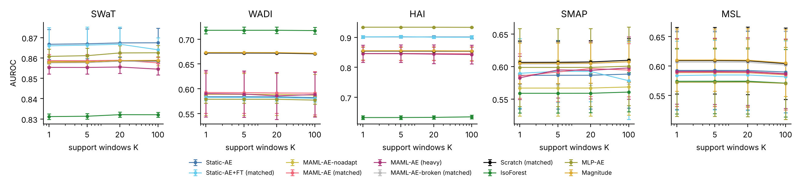
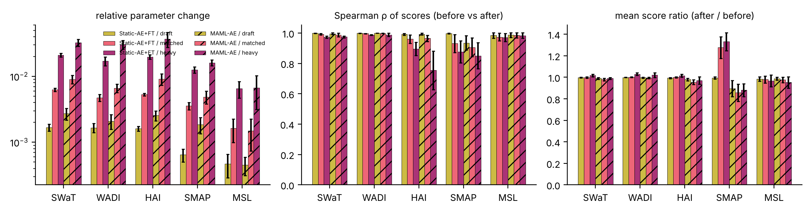
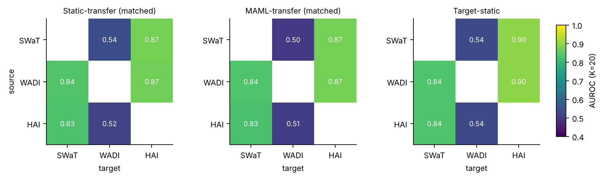
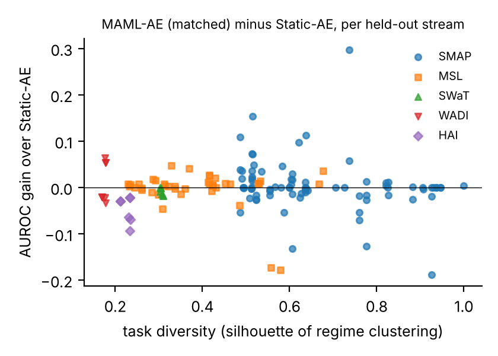

# 5 Results

The study produced 9,920 within-plant rows (5 datasets, 5 seeds, 77 distinct held-out streams, 4 support sizes, 11 method/setting combinations plus the magnitude reference) and 1,260 transfer rows. Tables report the mean and standard deviation over seeds after averaging over a dataset's streams within each seed; paired tests use the cells. A difference in AUROC below 0.01 is treated as negligible whatever its p-value, because with 100 or more cells the Wilcoxon test flags differences of 0.0003.

## 5.1 Q1: the meta-learner trains, and the broken pattern leaves no trace in the loss

Table 2 gives the control for all 25 (dataset, seed) runs. In every one of them the broken pattern produced a parameter change of exactly zero at every outer step, the meta-parameters at the end were bit-for-bit the initialisation, and the validation query loss after adaptation was the same number at step 50 and step 100. The corrected loop moved the parameters by 0.08–0.11 in Euclidean norm per step and brought the validation query loss down between step 100 and step 600, from 0.56 to 0.41 on SWaT, 0.81 to 0.68 on WADI and 0.77 to 0.66 on HAI, with smaller movements on the two telemetry sets whose losses start low (Figure 1).

Table 2. Gradient-path control, mean over five seeds. ‖Δθ‖ is the Euclidean norm of the meta-parameter change per outer step; "val" is the post-adaptation query loss on the held-out validation regime at outer step 100 and at step 600. The broken run is 100 steps; its validation loss at step 50 and at step 100 is the same number in all 25 runs, and its parameters at the end differ from the initialisation by exactly zero in all 25.

| Dataset | corrected ‖Δθ‖ per step | corrected val, step 100 → 600 | broken ‖Δθ‖ per step | broken max |θ − θ₀| | broken val, step 50 and 100 | static AE val |
|---|---|---|---|---|---|---|
| SWaT | 0.094 | 0.555 → 0.406 | 0.000 | 0.000 | 0.773, 0.773 | 0.129 |
| WADI | 0.107 | 0.809 → 0.675 | 0.000 | 0.000 | 0.829, 0.829 | 0.221 |
| HAI | 0.100 | 0.767 → 0.659 | 0.000 | 0.000 | 0.704, 0.704 | 0.291 |
| SMAP | 0.102 | 0.378 → 0.335 | 0.000 | 0.000 | 0.421, 0.421 | 0.189 |
| MSL | 0.078 | 0.133 → 0.129 | 0.000 | 0.000 | 0.146, 0.146 | 0.112 |

Two things in the table matter for what follows. First, the only quantity that separates a working meta-learner from a broken one is the parameter change; the broken run's validation loss is not absurd (0.70 on HAI against 0.66 for the corrected run at step 600, 0.146 against 0.129 on MSL), so a loss curve alone would not have raised an alarm. Second, even the corrected meta-model finishes with a post-adaptation query loss between 1.2 (MSL) and 3.1 (SWaT, WADI) times the validation loss of the static autoencoder trained on the same windows. The two numbers are not on the same data (the meta-model is scored on a regime it never saw, the static model on a random slice of the pooled windows), but the gap is large enough to say that 600 outer steps of four tasks do not bring the meta-model to the reconstruction quality of 2,000 ordinary mini-batches. Section 5.7 reports what a five-fold longer meta-training changes.

## 5.2 Q3, within a plant: the meta-learned model does not beat the static one, and neither beats the magnitude of the window on three benchmarks

Tables 3 and 4 give AUROC and AUPRC at K = 20 for every method; Figure 2 shows AUROC against K. The first row is the detector with no parameters: the mean squared standardised value of the window.

Table 3. Within-plant detection at K = 20, AUROC, mean ± sd over five seeds. Scratch is a random LSTM autoencoder from a seed the meta-learner did not use.

| method | SWaT | WADI | HAI | SMAP | MSL |
|---|---|---|---|---|---|
| Magnitude | 0.859 ± 0.000 | 0.673 ± 0.000 | 0.855 ± 0.000 | 0.605 ± 0.031 | 0.610 ± 0.054 |
| Isolation Forest | 0.832 ± 0.001 | 0.718 ± 0.007 | 0.633 ± 0.006 | 0.559 ± 0.030 | 0.574 ± 0.055 |
| MLP-AE | 0.862 ± 0.004 | 0.579 ± 0.008 | 0.933 ± 0.001 | 0.599 ± 0.060 | 0.573 ± 0.059 |
| Static-AE | 0.867 ± 0.007 | 0.584 ± 0.004 | 0.901 ± 0.004 | 0.587 ± 0.052 | 0.592 ± 0.067 |
| Static-AE+FT (matched) | 0.867 ± 0.008 | 0.582 ± 0.007 | 0.900 ± 0.004 | 0.592 ± 0.046 | 0.585 ± 0.061 |
| MAML-AE, no adaptation | 0.858 ± 0.002 | 0.589 ± 0.042 | 0.845 ± 0.021 | 0.567 ± 0.043 | 0.588 ± 0.058 |
| MAML-AE (matched) | 0.859 ± 0.003 | 0.592 ± 0.041 | 0.846 ± 0.023 | 0.597 ± 0.043 | 0.589 ± 0.059 |
| MAML-AE (heavy) | 0.856 ± 0.003 | 0.586 ± 0.047 | 0.844 ± 0.031 | 0.594 ± 0.044 | 0.591 ± 0.057 |
| MAML-AE-broken (matched) | 0.858 ± 0.000 | 0.672 ± 0.001 | 0.854 ± 0.001 | 0.605 ± 0.033 | 0.606 ± 0.055 |
| Scratch (matched) | 0.859 ± 0.000 | 0.672 ± 0.001 | 0.854 ± 0.001 | 0.607 ± 0.033 | 0.609 ± 0.058 |

Table 4. Within-plant detection at K = 20, AUPRC, mean ± sd over five seeds.

| method | SWaT | WADI | HAI | SMAP | MSL |
|---|---|---|---|---|---|
| Magnitude | 0.769 ± 0.000 | 0.181 ± 0.000 | 0.280 ± 0.000 | 0.245 ± 0.046 | 0.307 ± 0.054 |
| Isolation Forest | 0.726 ± 0.005 | 0.200 ± 0.017 | 0.053 ± 0.004 | 0.181 ± 0.050 | 0.244 ± 0.032 |
| MLP-AE | 0.776 ± 0.002 | 0.100 ± 0.014 | 0.344 ± 0.001 | 0.245 ± 0.065 | 0.241 ± 0.071 |
| Static-AE | 0.769 ± 0.008 | 0.101 ± 0.011 | 0.321 ± 0.008 | 0.241 ± 0.059 | 0.287 ± 0.059 |
| Static-AE+FT (matched) | 0.769 ± 0.009 | 0.101 ± 0.013 | 0.319 ± 0.008 | 0.250 ± 0.064 | 0.288 ± 0.058 |
| MAML-AE, no adaptation | 0.764 ± 0.003 | 0.114 ± 0.026 | 0.288 ± 0.004 | 0.226 ± 0.050 | 0.288 ± 0.059 |
| MAML-AE (matched) | 0.764 ± 0.004 | 0.116 ± 0.024 | 0.284 ± 0.006 | 0.237 ± 0.054 | 0.288 ± 0.060 |
| MAML-AE (heavy) | 0.762 ± 0.005 | 0.116 ± 0.022 | 0.283 ± 0.015 | 0.255 ± 0.064 | 0.288 ± 0.059 |
| MAML-AE-broken (matched) | 0.769 ± 0.000 | 0.180 ± 0.001 | 0.280 ± 0.001 | 0.241 ± 0.050 | 0.306 ± 0.054 |
| Scratch (matched) | 0.769 ± 0.000 | 0.182 ± 0.001 | 0.279 ± 0.001 | 0.242 ± 0.049 | 0.308 ± 0.054 |

Three rows of the table say the same thing. The magnitude reference, the random network and the "meta-model" from the broken loop agree to three decimals on SWaT, WADI and HAI and to within 0.005 on the telemetry sets. The reason is mechanical: an untrained LSTM autoencoder emits an output of small, nearly constant amplitude, so its reconstruction error is the squared norm of the input up to an offset. On the first 6,000 test windows of each dataset the Spearman correlation between the error of a random network and the window magnitude is 0.996 to 1.000. A paper that evaluated the broken loop would therefore have reported the magnitude detector under the name of a meta-learned one, and on SWaT it would have reported a respectable 0.858.

Against that reference the learned detectors do the following. On SWaT the static autoencoder gains 0.009 AUROC over magnitude (16 of 20 cells, p = 0.0001) and the meta-learned one gains nothing (0.0001, p = 0.93); the static model beats the meta-learned one by 0.009 (17 of 20 cells, p < 0.0001). On HAI the flat MLP autoencoder is the best detector at 0.933, the static LSTM autoencoder follows at 0.901, and the meta-learned LSTM autoencoder is at 0.846, below the magnitude reference by 0.009 (p = 0.025) and below the static model by 0.056 in 89 of 100 cells. On WADI training hurts: every trained autoencoder is between 0.58 and 0.59, the magnitude reference is at 0.673 and Isolation Forest at 0.718; the static model loses 0.089 to magnitude in all 20 cells. On SMAP and MSL no method is far from 0.6; the meta-learned and static models differ by 0.005 (p = 0.29) and 0.003 (p = 0.0003), both negligible, and both sit 0.014–0.021 below the magnitude reference. The meta-learned model never beats the static model by more than 0.01 on any dataset, and the one dataset where the sign favours it (WADI, +0.008) has p = 0.33.

The support size does nothing. Between K = 1 and K = 100 the AUROC of every method on every dataset changes by less than 0.012, and the only change above 0.005 is the meta-learned model on SMAP (0.585 to 0.595). This is expected for the methods that do not adapt, whose only dependence on K is the position of the calibration stretch, and it is the first sign that the adapting ones barely adapt.

## 5.3 Q2: K-shot adaptation moves the autoencoder very little and reorders almost nothing

Table 5 reports the three adaptation instruments pooled over datasets (per-dataset values are in Figure 3 and the released tables). At the draft setting, ten steps at 0.01, adaptation changes 0.2 % of the meta-model's parameter norm and 0.1 % of the static model's, and the rank correlation between scores before and after is 0.95–0.97 for the meta-model and 0.99 for the static one. The matched setting, the inner loop the meta-model was trained for, moves it by 0.5 % and reorders slightly more (ρ = 0.93–0.95). The heavy setting, fifty steps at 0.1, moves it by about 2 % and brings ρ down to 0.87–0.89, which is the only setting under which the evaluation ranking of windows changes in a way a reader would notice; on HAI the heavy setting takes ρ to 0.76 ± 0.13.

Table 5. Adaptation instruments pooled over the five datasets (mean ± sd over seeds of dataset means). ΔAUROC is relative to the same model before adaptation on the same cell.

| model / setting | K | rel. parameter change | score rank ρ | mean score ratio | ΔAUROC |
|---|---|---|---|---|---|
| MAML-AE / draft | 1 | 0.002 ± 0.000 | 0.973 ± 0.024 | 0.953 ± 0.039 | +0.009 ± 0.013 |
| MAML-AE / draft | 20 | 0.002 ± 0.000 | 0.958 ± 0.027 | 0.937 ± 0.045 | +0.015 ± 0.012 |
| MAML-AE / matched | 1 | 0.005 ± 0.001 | 0.952 ± 0.029 | 0.928 ± 0.042 | +0.010 ± 0.009 |
| MAML-AE / matched | 20 | 0.005 ± 0.001 | 0.940 ± 0.037 | 0.917 ± 0.045 | +0.016 ± 0.010 |
| MAML-AE / matched | 100 | 0.006 ± 0.001 | 0.929 ± 0.050 | 0.876 ± 0.067 | +0.014 ± 0.007 |
| MAML-AE / heavy | 20 | 0.017 ± 0.002 | 0.887 ± 0.059 | 0.917 ± 0.040 | +0.014 ± 0.004 |
| MAML-AE / heavy | 100 | 0.020 ± 0.002 | 0.871 ± 0.073 | 0.871 ± 0.068 | +0.015 ± 0.008 |
| Static-AE+FT / draft | 20 | 0.001 ± 0.000 | 0.993 ± 0.006 | 0.992 ± 0.005 | −0.001 ± 0.003 |
| Static-AE+FT / matched | 20 | 0.003 ± 0.000 | 0.952 ± 0.030 | 1.173 ± 0.085 | +0.001 ± 0.005 |
| Static-AE+FT / heavy | 1 | 0.012 ± 0.001 | 0.890 ± 0.046 | 1.219 ± 0.102 | +0.004 ± 0.005 |
| Static-AE+FT / heavy | 100 | 0.015 ± 0.001 | 0.934 ± 0.037 | 1.164 ± 0.044 | −0.002 ± 0.006 |

What adaptation does change is the scale of the scores. For the meta-model the mean score after adaptation is 0.88–0.95 of the mean before, that is, adaptation lowers reconstruction error across the whole stream; for the static model the heavy setting raises the mean score by 16–22 %, because fine-tuning a converged network on one to a hundred windows pulls it towards those windows and away from the rest. Neither change is visible in AUROC, which is scale-free, but both are visible to a threshold, which is why the instruments have to be reported separately from the score table.

The pooled ΔAUROC of +0.01 to +0.016 for the meta-model comes almost entirely from SMAP. There, adaptation at the matched setting lifts the meta-model from 0.567 to 0.597 (173 of 320 cells, p < 0.0001), and it does so because the un-adapted meta-model is the weakest neural detector on that dataset; the adapted model ends level with the static model (p = 0.29) and 0.014 below the magnitude reference. On the other four datasets the adapted and un-adapted meta-models differ by 0.0001–0.0035. The pattern is the one Raghu et al. [@raghu2020anil] reported for classification, in a sharper form: the inner loop that gives the method its name changes the ranking of windows by a few per cent and the AUROC by a few thousandths, and the detector that is being evaluated is, for practical purposes, the meta-initialisation.

The broken-loop model and the Scratch model show what adaptation does to a network that has never been trained. At the matched setting their parameters move by 0.3–0.4 % and their scores keep ρ = 1.000 with their own un-adapted scores, which are the magnitude reference; at the heavy setting they move by 2.5–4 %, more than any trained model, and still keep ρ ≥ 0.96. Five to fifty gradient steps on at most a hundred windows do not make a detector out of a random network, and they do not make a different detector out of a trained one.

## 5.4 The deployed threshold costs more than any modelling choice

Table 6 sets the point-wise F1 at the label-free threshold beside the oracle best F1 for four detectors. The gap is 0.19 F1 on SWaT, 0.06–0.10 on WADI, 0.22–0.25 on HAI, 0.15–0.16 on SMAP and 0.12–0.13 on MSL, and on every dataset but WADI it dwarfs every difference between methods in Table 3. On SWaT the static autoencoder reaches F1 0.56 with the threshold calibrated after 20 or 100 support windows but 0.39–0.40 when calibrated after 1 or 5, because the 300-window calibration stretch then starts a few windows earlier and happens to include a short stretch of quieter operation; nothing about the model changed. On WADI every autoencoder alarms on about 60 % of the evaluation stream against an anomaly rate of 6 %, because the calibration stretch at the start of the attack recording is not representative of the rest of it, a drift inside the attack recording itself; the threshold, not the ranking, is why its F1 is 0.11. On HAI, SMAP and MSL the deployed F1 is 0.14–0.22 against oracle values of 0.30–0.46.

Table 6. Deployed point-wise F1 at the peaks-over-threshold level against the oracle best F1, K = 20, mean over seeds. Alarm rate is the share of evaluation windows above the threshold; the anomaly rate is the share of labelled windows.

| Dataset | method | F1 (deployed) | best F1 (oracle) | precision | recall | alarm rate | anomaly rate |
|---|---|---|---|---|---|---|---|
| SWaT | Static-AE | 0.563 | 0.755 | 0.465 | 0.759 | 0.218 | 0.120 |
| SWaT | MAML-AE (matched) | 0.572 | 0.755 | 0.464 | 0.753 | 0.198 | 0.120 |
| SWaT | Magnitude | 0.407 | 0.755 | 0.271 | 0.816 | 0.361 | 0.120 |
| SWaT | Isolation Forest | 0.420 | 0.746 | 0.294 | 0.743 | 0.307 | 0.120 |
| WADI | Static-AE | 0.113 | 0.176 | 0.062 | 0.615 | 0.590 | 0.060 |
| WADI | MAML-AE (matched) | 0.116 | 0.212 | 0.064 | 0.653 | 0.611 | 0.060 |
| WADI | Magnitude | 0.127 | 0.325 | 0.069 | 0.774 | 0.669 | 0.060 |
| WADI | Isolation Forest | 0.226 | 0.320 | 0.142 | 0.552 | 0.232 | 0.060 |
| HAI | Static-AE | 0.203 | 0.456 | 0.360 | 0.327 | 0.113 | 0.021 |
| HAI | MAML-AE (matched) | 0.220 | 0.437 | 0.389 | 0.312 | 0.073 | 0.021 |
| HAI | Magnitude | 0.207 | 0.432 | 0.375 | 0.322 | 0.067 | 0.021 |
| HAI | Isolation Forest | 0.058 | 0.109 | 0.059 | 0.109 | 0.038 | 0.021 |
| SMAP | Static-AE | 0.154 | 0.305 | 0.176 | 0.190 | 0.110 | 0.132 |
| SMAP | MAML-AE (matched) | 0.142 | 0.303 | 0.164 | 0.190 | 0.104 | 0.132 |
| SMAP | Isolation Forest | 0.019 | 0.225 | 0.127 | 0.037 | 0.019 | 0.132 |
| MSL | Static-AE | 0.192 | 0.324 | 0.266 | 0.220 | 0.132 | 0.143 |
| MSL | MAML-AE (matched) | 0.204 | 0.329 | 0.278 | 0.225 | 0.134 | 0.143 |
| MSL | Magnitude | 0.216 | 0.346 | 0.297 | 0.267 | 0.141 | 0.143 |
| MSL | Isolation Forest | 0.115 | 0.290 | 0.228 | 0.135 | 0.058 | 0.143 |

The oracle column is the number most papers report. Read on its own it would say that the autoencoders are good detectors on SWaT (0.755) and usable on HAI (0.44–0.46); read beside the deployed column it says that a plant operator who set the threshold without labels would see 0.56 and 0.20, and on WADI would switch the detector off within an hour. The ranking of methods is also not the same in the two columns: Isolation Forest has the best deployed F1 on WADI by a wide margin (0.226, because it alarms on 23 % of the stream rather than 60 %) while its oracle F1 is level with the magnitude reference.

## 5.5 Q3, across plants: transfer reaches the target-trained model only where the target is easy, and meta-training adds nothing

Table 7 gives the six transfer directions at K = 20 and K = 100 (Figure 4 maps the K = 20 values). The target decides everything. With SWaT as target every model in the shared 32-component space, including the random network, is between 0.824 and 0.838, and the model trained on SWaT itself is at 0.835: in that space SWaT's attacks are detected by magnitude, as they were in the native space, and there is nothing for transfer to transfer. With WADI as target every model, including the one trained on WADI, is between 0.47 and 0.55: the 32 components keep 91 % of WADI's normal-operation variance but not the part of it that separates attacks, and no source helps. With HAI as target the two source-trained models reach 0.87 from either SWaT or WADI, against 0.895 for the target-trained model and 0.78 for the random network; this is the one direction in which pre-training on another plant carries over something that K target windows cannot supply.

Table 7. Cross-plant transfer, AUROC on the target's attack recording(s), mean ± sd over five seeds, matched adaptation. Source-static is the static autoencoder trained on the source plant and adapted on K target windows; MAML-transfer is the meta-model trained on the source plant's regimes and adapted the same way.

| method / K | HAI→SWaT | HAI→WADI | SWaT→HAI | SWaT→WADI | WADI→HAI | WADI→SWaT |
|---|---|---|---|---|---|---|
| Target-static | 0.835 ± 0.001 | 0.540 ± 0.018 | 0.895 ± 0.006 | 0.540 ± 0.018 | 0.895 ± 0.006 | 0.835 ± 0.001 |
| Source-static, no adaptation | 0.833 ± 0.002 | 0.512 ± 0.052 | 0.868 ± 0.005 | 0.550 ± 0.019 | 0.864 ± 0.005 | 0.838 ± 0.000 |
| Source-static, adapted / 20 | 0.832 ± 0.002 | 0.523 ± 0.046 | 0.874 ± 0.004 | 0.545 ± 0.019 | 0.870 ± 0.006 | 0.837 ± 0.000 |
| Source-static, adapted / 100 | 0.831 ± 0.002 | 0.522 ± 0.047 | 0.874 ± 0.006 | 0.542 ± 0.019 | 0.869 ± 0.005 | 0.837 ± 0.000 |
| MAML-transfer, no adaptation | 0.832 ± 0.001 | 0.472 ± 0.012 | 0.870 ± 0.000 | 0.491 ± 0.029 | 0.862 ± 0.010 | 0.837 ± 0.001 |
| MAML-transfer / 20 | 0.829 ± 0.000 | 0.510 ± 0.009 | 0.875 ± 0.001 | 0.499 ± 0.024 | 0.874 ± 0.005 | 0.836 ± 0.001 |
| MAML-transfer / 100 | 0.828 ± 0.001 | 0.506 ± 0.009 | 0.875 ± 0.001 | 0.495 ± 0.023 | 0.873 ± 0.004 | 0.835 ± 0.001 |
| Scratch / 20 | 0.824 ± 0.002 | 0.490 ± 0.010 | 0.780 ± 0.004 | 0.490 ± 0.010 | 0.780 ± 0.004 | 0.824 ± 0.002 |

Meta-training on the source plant's regimes does not change the transfer. Paired on cells, the meta-model and the static source model adapted the same way differ by +0.0004 (SWaT→HAI, p = 0.50), +0.0034 (WADI→HAI, p = 0.11), −0.003 (HAI→SWaT), −0.001 (WADI→SWaT), −0.015 (HAI→WADI, p = 0.56) and −0.046 (SWaT→WADI, 0 of 10 cells); the heavy setting does not change the picture. The adaptation step itself is worth +0.005 to +0.037 to the meta-model on the HAI and WADI targets, which again says that its initialisation starts below the static model and adaptation brings it level, not above.

## 5.6 Task diversity does not predict a meta-learning gain

The explanation we offered in our own earlier draft for a weak meta-learning result was that a single plant does not supply enough distinct tasks. The per-stream diversity scores let that be tested. The silhouette of the regime clustering is 0.18 on WADI, 0.23 on HAI, 0.31 on SWaT, 0.39 on average over MSL channels and 0.66 on average over SMAP channels; the gain of the matched meta-model over the static model on the same streams is +0.008, −0.056, −0.009, −0.003 and +0.005. Across the 120 (channel, seed) cells of the two telemetry sets, where the diversity score and the gain are both per channel, the Spearman correlation is −0.20 (p = 0.029): if anything, the more distinct the regimes in a channel, the less the meta-learned model gains (Figure 5). The hypothesis is not supported by these data, and the direction of the weak effect is the opposite of the one it predicts.

## 5.7 Longer meta-training

Table 2 left open whether 600 outer steps had simply stopped the meta-learner short. We therefore repeated the three testbeds with 3,000 outer steps for seeds 0 and 1, everything else unchanged, and compared with the same seeds of the main run. Five times the meta-training lowered the best post-adaptation validation loss from 0.46 to 0.33 on SWaT, 0.71 to 0.58 on WADI and 0.60 to 0.42 on HAI, so the meta-model was indeed still improving as a reconstructor; it remained 1.3 (HAI) to 2.7 (SWaT, WADI) times the static model's validation loss. Detection did not follow. The AUROC of the matched meta-model moved from 0.855 to 0.862 on SWaT, 0.597 to 0.593 on WADI and 0.873 to 0.864 on HAI, against 0.865, 0.581 and 0.898 for the static model on the same seeds; the un-adapted meta-model moved by 0.002 to 0.007. The adaptation instruments were unchanged to the second decimal (relative parameter change 0.005–0.007 at the matched setting, rank correlation 0.90–1.00). Longer meta-training makes a better-reconstructing meta-model and the same detector.
